# Unity.SpaceGod

The real solar system and Alpha Centauri in Unity 6, on live orbital mechanics, with an economy and a war you can watch or join at the helm of any ship, at playable or true scale.

     

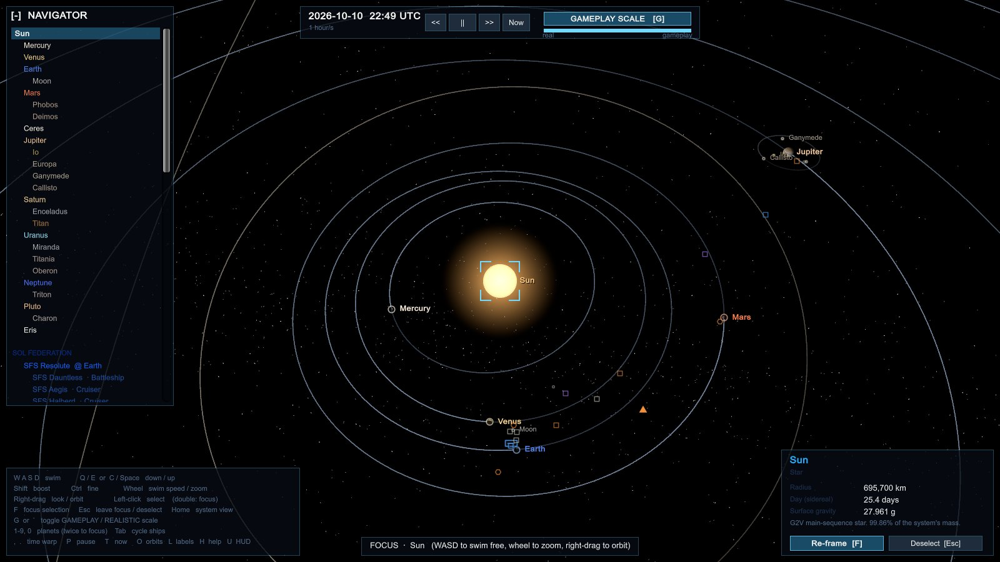

A ground-up rebuild of [ExperimentSolarSystem](https://github.com/mindattic/ExperimentSolarSystem) (Babylon.js). Nothing here is a saved position: every planet and moon is propagated from orbital elements, and every ship flies a planned trajectory its drive suits: a torch's flip-and-burn, or a slow boat's transfer orbit under the Sun's gravity.

## Why

- **Real orbital mechanics.** Planets come from JPL's Keplerian elements (Standish, 1800-2050), solved with Kepler's equation for the current date. Open it today and the planets are where they really are; Venus, for example, is near inferior conjunction in October 2026.
- **Homeworld 3 navigation.** Free swim with WASD and mouselook, then select something and press F: the camera flies to it, orbits it, and rides along as it moves. Any movement key drops you straight back into free swim from where you are.
- **Gameplay and realistic scale, live.** Press G and everything eases between a compressed, playable layout and true proportions (1 unit = 1,000 km) over about 2.5 seconds. Whatever you are looking at stays framed.
- **Billboards when things get small.** Anything under a few pixels, ships and planets alike, turns into a class-shaped icon in its faction colour, so you can always see where everything is, even at true scale where Earth is a speck. A ship shorter on screen than the swap point (5 px by default, Settings > LOD & render budget) drops its 3D model for its icon with its name beside it (all ships, warships only, or none; a name that would overlap another is left off), and clicking the icon or the name opens its card: status, hull and shields, armament by weapon kind with any shot away, crew, orders or cargo, and its record. A card too long for the screen scrolls.
- **A living system.** Twenty-one settlements run a supply-and-demand economy that merchants trade on by themselves; three navies and a pirate band fight real battles with lasers, missiles and carrier fighters, losing ships and ports; and traffic between planetary systems rides X3-style hyperlanes. You watch it happen.
- **Take the helm when you want to.** Press P on any ship to fly it yourself: steer with the mouse, fire its forward guns, cruise across open space, trade crates and fill its tanks at a port, answer a pirate's demand, latch on to a derelict or a wreck and pick it over, turn outlaw and run from the patrols, or fly through a jump gate to another star.

## Design principles

What the game is for, and where it is going, is in [docs/VISION.md](docs/VISION.md): a fully alive, galaxy-spanning simulation that is at once a strategy, dogfighting, capital-ship broadside, trading and diplomacy game, which you can step into and steer anywhere or leave to play out on its own.

Every change is held to these. Where the game falls short of one today, new work moves toward it and never further away.

1. **Expandable and extensible first.** New mechanics, ship classes, factions, star systems and polity behaviours plug in through clear extension points and data: a new spec, table entry or registered handler, not edits threaded through the core loops of `Fleet`, `War` or `UnitySpaceApp`. If adding the second of something means touching the code that runs the first, add the extension point first.
2. **The universe is fully flyable.** Given long enough, a pilot can fly from one end of the galaxy to the other in continuous space, the way I-War 2 lets you point at a place, engage and eventually arrive. Jump gates and hyperlanes are shortcuts that carry most traffic, never the only way, and capital ships and deep-space explorers can cross between stars under their own power. Today a gate crossing is a timed hop and the trip between stars is a camera glide; those are stand-ins to be replaced, so build nothing that assumes a ship can only leave a system by a gate, or that space between systems is empty or unsimulated. Coordinates must hold their precision at galactic distances.
3. **Render only what can be seen.** In a 3D world the size of the universe, a full-detail model for something too far or too small to see is waste. Everything degrades by apparent size: full model, simpler model, icon or impostor, then one marker for a fleet or a system, and nothing at all below a pixel. The floating origin and the billboard icons are the start of this; new renderable things join the same scheme instead of always drawing in full.
4. **No loading screens.** Systems, ships and assets stream in and out in the background without stalling a frame. The only cover allowed is visual trickery at a jump gate (a transit effect long enough to finish loading what lies on the far side); arriving anywhere by plain flight never pauses to load.
5. **Reachable and adjustable in game.** As much as possible can be seen and changed from the in-game settings menu: graphics and render quality, controls, simulation speed and scale, difficulty, and the tuning of the simulation itself. A value only a developer can change by editing code is a missed setting. New settings register in one place so the menu picks them up without being edited by hand, and each is remembered per profile like the display settings are today.

## Gameplay vs realistic

The same moment, focused on Earth, before and after pressing G. At gameplay scale the Sun, Venus and the Moon crowd the view. At realistic scale they drop back to their true distances and sizes, while Earth stays put.

| Gameplay | Realistic |
| --- | --- |
| 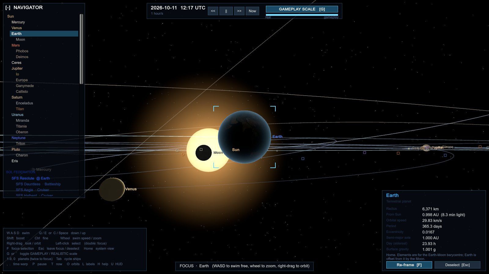 | 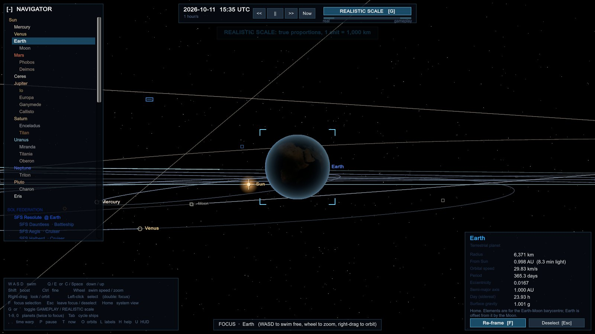 |

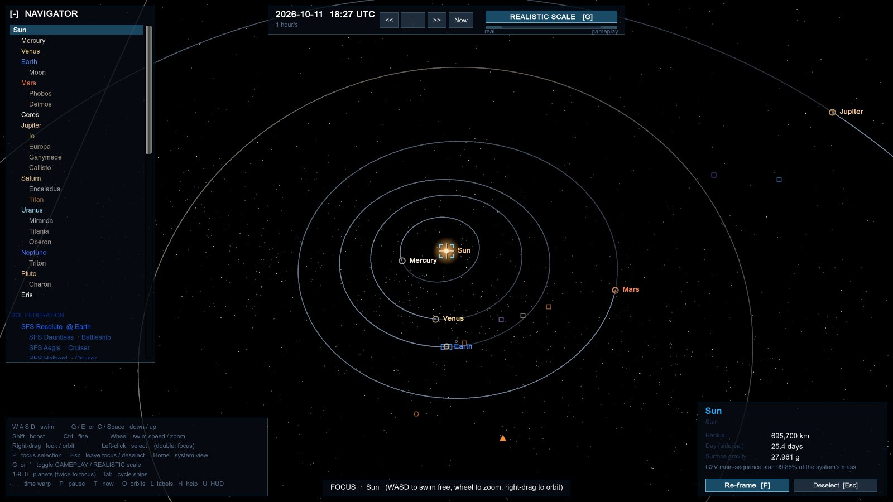

## Features

### Simulation

- **Ephemeris.** The Sun, 8 planets, Ceres, Pluto, Eris and 14 moons. Earth is offset from the Earth-Moon barycentre by the Moon. The Moon has real nodal regression and apsidal precession. The other moons use JPL's satellite mean elements in their Laplace planes, fitted to JPL Horizons, so each sits within half a degree of its true place on its orbit across 2000-2050 (Phobos and Miranda within 2). Uranus's moons roll with it and Triton goes backwards.
- **Rotation and orientation.** Real IAU poles (RA/Dec converted to the ecliptic) and sidereal rotation periods, with retrograde rotators handled.
- **Scale model.** A radial mapping about each parent that sends every surface to its displayed surface at any blend, so orbits keep their true shape and direction in both modes and nothing in low orbit ends up inside a planet. Intermediate blends interpolate in log space.
- **Fleet.** Five factions in Sol, with yards building the merchant hulls trading companies order (no more than 170 traders in all) plus warships, and battles destroying them. Ships park in circular orbits at the real Keplerian rate for the body's GM. They depart when their orbit faces the target, then fly a constant-thrust brachistochrone (accelerate, flip at the midpoint, brake), plus a steady push that takes them from their parking orbit's velocity to the destination's, so they leave and arrive moving with the world. A hop within one planet's system (Earth to the Moon, Io to Europa) is flown in that planet's frame. Each transit is planned once, as an intercept against where the destination will be on arrival, dog-legs around the Sun or planet at the centre of its frame, and is checked against running into the bodies at either end (and steered wide of the planet a moon orbits). Between planetary systems ships take the hyperlanes instead (see below).
- **Drive-appropriate trajectories.** Torches (warships, couriers, breachers, fighters, 0.25 g and up) keep the flip-and-burn and pay a gravity correction for holding their straight line through the wells at either end and the frame's own pull, integrated along the path. Low-thrust haulers (freighters and ore haulers) weigh it against a transfer orbit: a Lambert conic under the frame's gravity (universal variables, either way round), patched onto an escape hyperbola that leaves from the ship's own spot in its parking orbit and a capture hyperbola that circularises it in its new one, handing over at each world's sphere of influence (Laplace's a·(m/M)^0.4), with the small trims at the handoffs counted in. The planner prices every option at the hull's time value (its crew's days, money tied up in its cargo, four times as much for contracted supplies) plus its propellant, so cheap freight falls across slowly on a few km/s while urgent cargo pays hundreds of km/s to be there in days; a slow boat with nothing pressing searches the coming synodic period for its launch window and waits in port for it (Earth to Mars about every 780 days, Mars some 44° ahead), and may fly straight across on one rather than pay the lanes' tolls. Coasting, its drive is dark: only the escape and capture burns light it.
- **Lagrange points** (`Core/Lagrange.cs`). Every body pair has its five: L1, L2 and L3 on the line through the pair at the restricted three-body problem's distances for its mass ratio, L4 and L5 at the equilateral points 60° ahead and behind, all moving with the pair (a planet's points about the Sun use it and its moons together, as JPL does). Checked against JPL Horizons' own Lagrange-point ephemerides: Sun-Earth L1 and L2 sit 1.5 million km from Earth, Earth-Moon L1 at 84.9% of the way to the Moon and L2 at 116.8%.
- **Jupiter's Trojans.** Hektor and Eurybates in the Greek camp 60° ahead of Jupiter and Patroclus in the Trojan camp 60° behind, as full bodies on their JPL Small-Body Database orbits, checked against Horizons. The Belt Consortium mines the Greek camp (Skamandrios Diggings on Hektor, Queta Camp on Eurybates, reached by lanes from Jupiter) and the Black Banner hides Menoetius Hold on Patroclus; a fight there before it is found is a skirmish "in the Trojans".
- **Sim clock.** Real time up to 1 year per second, starting at the current UTC date.

### Rendering

- **Floating origin.** The Unity camera never leaves the world origin. Positions are kept in doubles and every renderer is placed at scene position minus camera position, so a 600 m freighter renders cleanly 2.4 million km from Earth. Near and far planes adapt to the nearest surface.
- **Custom URP shaders** lit by the Sun's camera-relative position rather than a range-limited light: day/night terminator, atmosphere rims, procedural surfaces for bodies with no honest colour map, a granulating Sun with corona, Saturn's rings (C, B, Cassini Division, A, Encke Gap) shadowed by the planet, engine plumes, and a starfield with the Milky Way along the real galactic plane.
- **Ships.** Procedurally kit-bashed carriers (flight deck, island, hangar glow), battleships (turrets, superstructure), cruisers and destroyers in faction livery. Warship guns, launchers, point defence, shield emitters, sensor masts and hangar bays are separate parts bolted on at the hardpoints the combat model uses. Fighters are their own small twin-gun hull. Freighters, ore haulers and couriers use Kenney Space Kit models. A ship's nose stays prograde through the whole transit, braking half included, and every hull trails engine embers while it burns.
- **One-pixel orbit trails** that fade behind each body. Moon orbits fade in as you approach their planet.

### Real surfaces weather and asteroids

- **Real maps on 19 worlds.** The Moon (LRO LROC colour), Mercury (MESSENGER), Mars (Viking), the four Galilean moons (Galileo and Voyager), Titan, Enceladus, Phobos, Deimos, Ceres (Dawn), Pluto and Charon (New Horizons), Triton, Miranda, Titania and Oberon (Voyager), with relief shading from real elevation data on the Moon (LOLA), Mars (MOLA) and Mercury (MESSENGER DEM). Every map is turned by its IAU prime meridian, or faces its planet for synchronous moons, so the Moon shows Earth its real near side and Pluto keeps its 0° meridian on Charon. Gaps the spacecraft never imaged are a flat neutral grey, and every caveat (Io's muted false colour, Triton's ultraviolet-based colour reduced to brightness, Titan's haze) is listed in [SOURCES.md](Assets/UnitySpace/Resources/Textures/SOURCES.md).
- **Gas giants that move with their real winds.** Each latitude of Jupiter, Saturn, Uranus and Neptune drifts at its measured zonal wind speed (Cassini, Voyager and Hubble profiles; Jupiter's 23.7°N jet runs 165 m/s, about 13° of longitude a day) through a looping flow map with advected turbulence, on the simulation clock. Jupiter's Great Red Spot sits at its current System III longitude (BAA and JUPOS measurements, drifting 0.31° a day) and turns counter-clockwise, an anticyclone, about once in 6 days. The swirl fades out at time warps where it would strobe.
- **Titan and Venus as eyes see them.** Titan is an orange haze ball with Cassini's 938 nm surface map faint beneath; Venus is its nearly featureless cloud deck, super-rotating in 4 days.
- **The asteroid belt, fully populated.** 111,267 real asteroids from the JPL Small-Body Database (every numbered main-belt asteroid brighter than H 15.5, and every Jupiter Trojan brighter than H 15), each propagated on its own Kepler orbit on the GPU in one draw call, mapped through the same gameplay/realistic scale as the planets. The Kirkwood gaps and the two Trojan clouds come straight from the data. Vesta, Pallas, Hygiea, Juno, Psyche, Interamnia and the Trojan Achilles are labelled; the Trojans Hektor, Patroclus and Eurybates are full bodies.

| The Moon (LROC colour, LOLA relief) | Jupiter and the Great Red Spot | Io |
| --- | --- | --- |
| 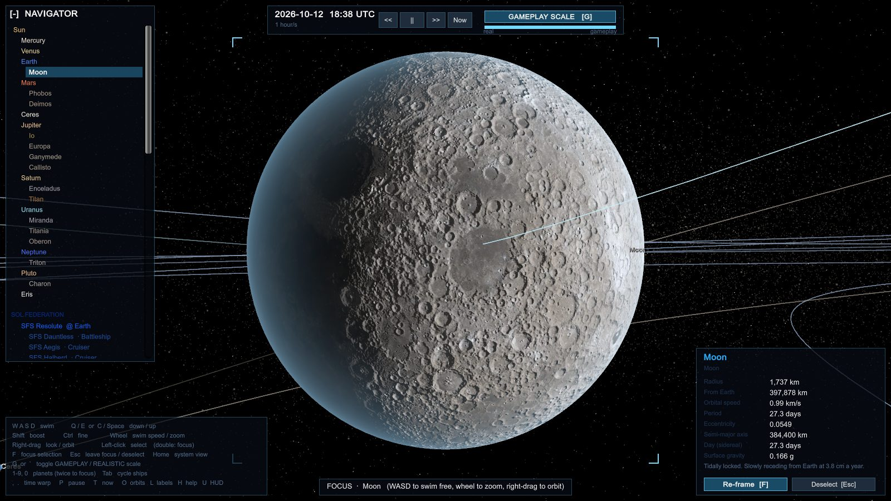 | 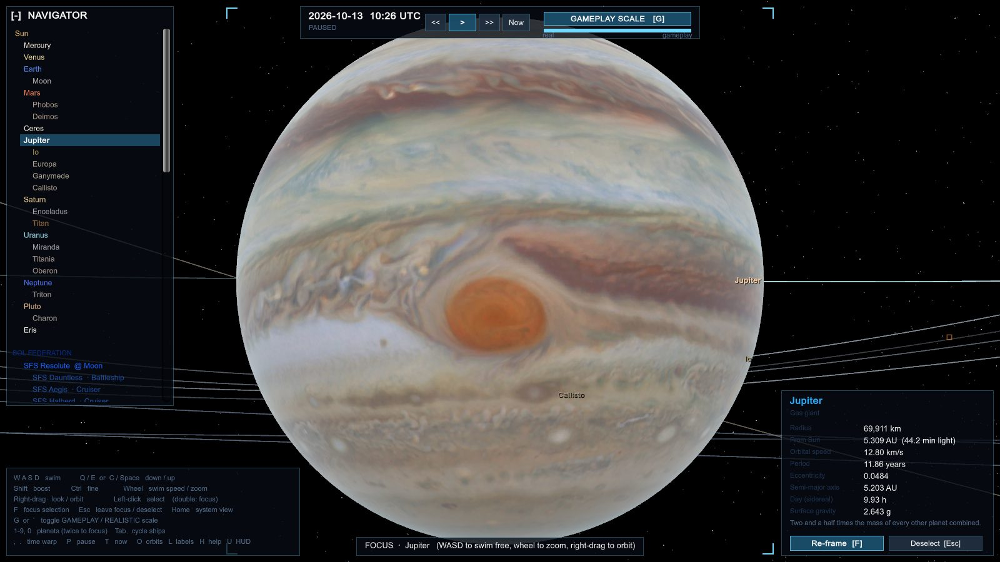 | 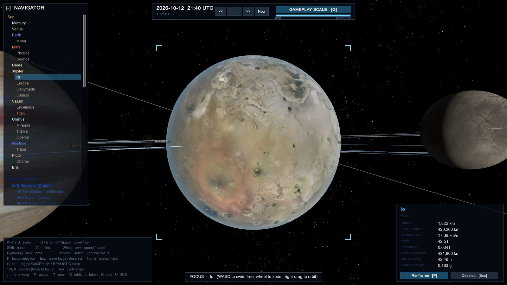 |

| Mars (Viking colour, MOLA relief) | The asteroid belt at gameplay scale | The asteroid belt at true scale |
| --- | --- | --- |
| 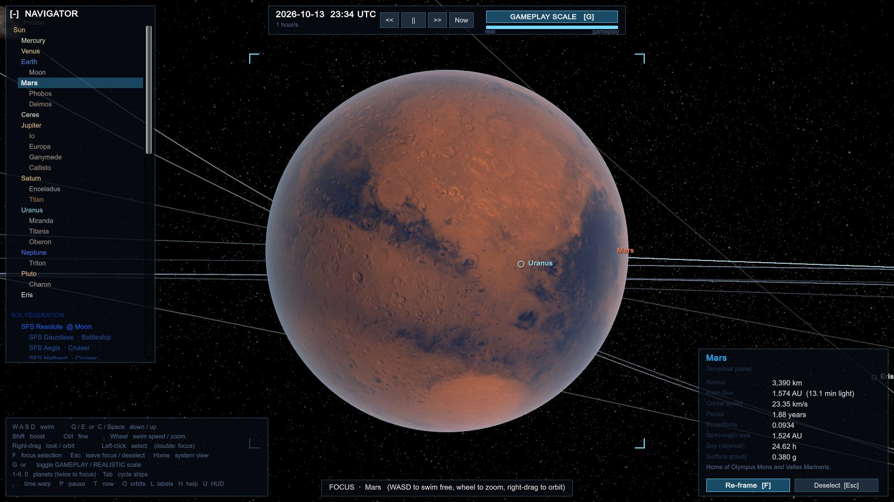 | 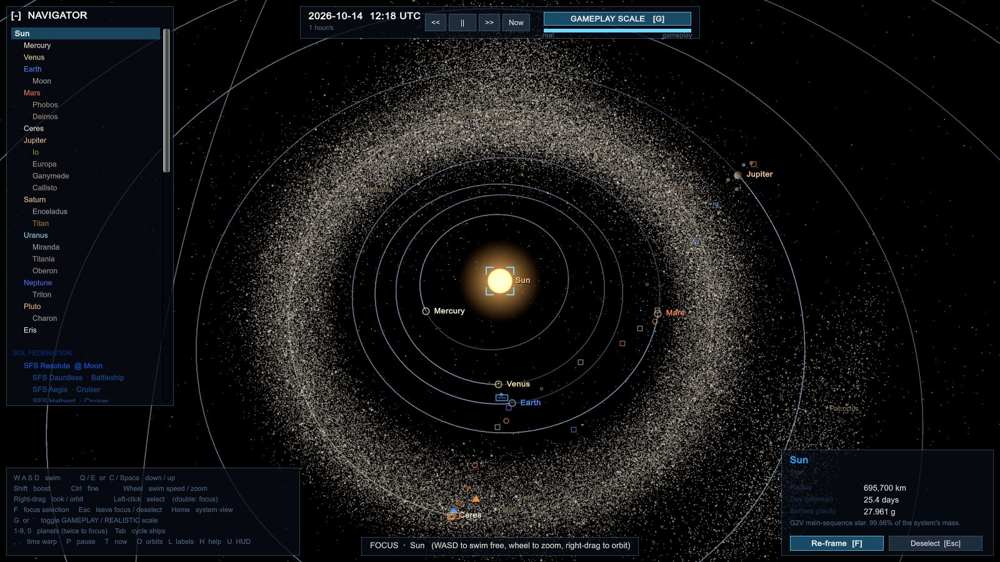 | 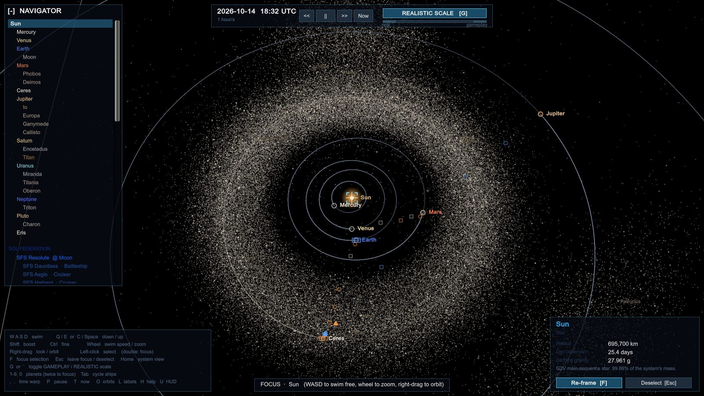 |

### The living system

The orbits are real; everything below is fiction, placed on worlds that plausibly hold what they produce.

- **Economy.** Sixteen goods: food, water and medical supplies; helium-3; nickel-iron, copper, zinc, platinum-group metals, rare earths and titanium; hydrocarbons and nitrogen; refined alloys, electronics, machinery and munitions. Eighteen settlements (Earth's orbital industry, Tycho City, Ares Prime, Ceres Hub, Ganymede Union, Kraken Port on Titan and so on) mine what their world has (ice moons sell water, Titan hydrocarbons, Io copper and zinc from its sulphide flows), turn it into goods through production chains (smelters, electronics fabs, machine works, pharmaceutical labs, munitions plants, shipyards), feed their people and price every good from their stock against what they use. Facilities grow when what they make sells dear and shrink when it is glutted.
- **People and labour.** Each person eats, drinks and breathes by NASA's planning figures: 1.76 kg of food a day, and the water a closed loop loses (98% recovered on a station, as on the ISS since 2023, less in a colony with showers), plus the water split for oxygen and the nitrogen that replaces leaked air. Populations grow when fed, shrink when not, and migrate toward food, water and better expected wages, never across a war front. Every facility needs a crew, life support first; short-handed it makes less, and under a quarter of its crew it stalls. Wages are taxed into the owner's treasury alongside port taxes, and the treasury pays for new hulls, refits, defence platforms and every warship's daily upkeep, so a starving, emptying economy really does weaken its navy. Figures and assumptions are in [Economy/SOURCES.md](Assets/UnitySpace/Core/Economy/SOURCES.md).
- **Trade.** Freighters, ore haulers and couriers each pick the cargo and destination that earn the most per day of travel, counting deliveries already on the way, so goods flow from surplus to shortage without a script. Every run is priced by what it really costs: the propellant its burns throw out with that cargo aboard (at the local price), a toll for every hyperlane it rides (paid to whoever keeps that system's ramps), and the crew's days. A run the tanks cannot cover, with a reserve, is left out; a ship running low with nothing to carry makes for the nearest port that sells propellant. Owners post supply contracts for essentials their outposts are short of. Profits go to the ship's faction, ports tax the trade, and traders steer clear of where the fighting has been.
- **Propellant.** Every hull has a fusion drive with its own exhaust velocity (2,200 km/s for an ore hauler to 4,500 for a courier) and a dry mass and tanks of its own, and the rocket equation sets what each manoeuvre costs: a full hold cuts a freighter's delta-v by nearly two thirds. Civilian ships pay for every transit from their tanks (the flip-and-burn plus matching velocity at each end and its gravity correction, or a transfer orbit's escape, capture and trim burns; hyperlane rides cost no propellant) and fill up in port with water or hydrocarbons, whichever is cheaper there, and the helium-3 that burns them. Those sales are propellant demand the markets stock for. A ship that cannot cover its next trip waits in port for propellant; one that runs dry in flight (now and then a holed tank vents most of what it carries) drifts where its tanks gave out and calls for a tanker, which fills it in a couple of days at a premium, and its call is a distress adventure the player can answer by pumping some of their own reaction mass across.
- **War.** The Sol Federation and the Outer Reach Compact are at war (it cools to ceasefires and flares up again); the Belt Consortium trades with both and hunts pirates; the Black Banner raids busy ports from Blackwater on Deimos and from three hidden bases on real belt asteroids (Hollow Iron on Psyche, Lantern Rock on Lutetia, Dactyl's Rest on Ida). A hidden haven is off the map until a warship's scanners pass within 2 million km of it (a merchant's within 1 million), a navy's sensors hold raiders parked there or burning in to it, a navy follows beaten raiders home, or captured raiders give it away. A navy that finds one sends a strong group to break its two gun platforms and then board it (seizing its stolen goods) or level it; a pilot who has broken one can do the same (1 board, 2 destroy). A fallen haven's raiders lie low and no new bands sail from it until the pirates rebuild it, 180 days on. Fleet groups take orders (patrol, attack a weak enemy port, defend one under attack, besiege, refit at a yard). A battle starts wherever hostile forces meet: groups, merchants or a settlement's orbital defence platforms. A port with no platforms left, held by a besieging group for 4 to 20 days, changes hands; refits and new hulls are paid for in alloys, electronics and munitions bought from the yard's market.
- **Capital ship combat.** Battles run a tactical simulation in a local space tens of km across: ships manoeuvre to their weapons' range, every hardpoint picks its own target, lasers, railguns and missiles hit particular subsystems (guns first, then shields, engines and the bridge; a lost reactor takes the ship with it), point defence shoots missiles and fighters down, and damaged ships break off and run. Turrets traverse onto their targets, shot-away hardpoints leave burning scars, breaches open as the hull falls, and a destroyed ship breaks into bow and stern that tumble apart and burn out.
- **Weapons that travel.** Railgun and gun rounds fly a lead-compensated straight line and land only when they arrive; a miss keeps flying and fades, and the miss rate depends on the target's size. Beams sweep onto their target and leave a scorch, with muzzle flash and recoil. Destroyers carry a fixed spinal railgun.
- **Wrecks.** A ship destroyed in battle leaves a slowly tumbling hull inside a drifting debris field where it died, at a body or beside a hyperlane, carrying its cargo as salvage until it breaks up and is cleared.
- **Surrender.** An outgunned, battered hull can strike its colours instead of fighting to the last: it breaks off, powers down its weapons and hails. How soon depends on its damage, the odds and its faction's temperament (pirates break first, navy crews last). Its captor ransoms the cargo, takes the ship through the boarding path, or lets it go.
- **Outfitting.** Every hull has slots: its weapon hardpoints (light mounts take point defence or a laser, heavy ones any turret, and only a mount bearing on the bow a spinal railgun), its shield and engine mounts, and one to six internal bays by class. A shipyard (or a raider haven) fits lasers, heavy lasers, railguns, missile launchers and point defence, hardened shield generators (half again a stock one's share of shield and regen), torch drives (30% more thrust), armour plate (more armour and hull points, and mass to push), cargo racks (more hold), scanner suites (half the hull's sensor range again and finer resolution, and a million km more reach for hidden havens) and a brig. Each module is bought from that yard's own market, its alloys, electronics, machinery and munitions at the yard's prices, plus a quarter again for labour, less half the old part's materials sold back (nothing for one shot away); a yard short of a material cannot fit what needs it. The loadout rebuilds the hull's combat spec, and every added tonne costs acceleration and delta-v. Navies and raiders upgrade their own warships while they refit at their yards, out of a flush treasury and the yard's surplus. A brig takes prisoners off a prize, handed over in port for 50,000 credits a head for raiders (20,000 ransom for anyone else).
- **Construction.** Everything that can be built in space is a hull frame in one catalogue (`HullFrames`): every ship class's designs, from fighters to carriers, the defence platform and an orbital station, and weapons and sensor satellites. A frame's sockets are its real hardpoints, each with its place on the hull, its firing arc, its size (small, medium, large) and a stable socket name, so a model library can set a turret, launcher or tube exactly where the battle fires from. A `ConstructionPlan` fits parts into the sockets and gives the hull's spec, bill of materials and price, and becomes a new ship's loadout or a station's or satellite's combat state. Battleships carry two bow torpedo tubes and cruisers one: a fixed launcher with six heavy torpedoes (900 damage, slow enough for point defence to work on), fittable in any torpedo socket or bow-bearing heavy mount. New frames plug in with `HullFrames.Register`.
- **Escape pods and crews.** Every crewed hull carries escape pods, one for every 20 people aboard (17 on a destroyer, over 200 on a carrier). As a hull goes down in battle, or is scuttled or cast adrift, whoever is still aboard makes for them: about half to four fifths when it is shot apart, a fifth to under half when the reactor goes, nearly everyone when the crew are put off in good order. The pods drift away from the hull and broadcast for ten days of air. Whoever finds them decides what happens next. Their own side or a friendly ship (patrols search, merchants come across them) brings the crew home and is paid by their owners. Pirates haul them in as hostages and ransom them back for 60,000 cr a head; hostages nobody can pay for are pressed into pirate crews, and hostages held at a haven go free if it falls. An enemy navy keeps them as prisoners of war until the fighting stops. Raiders picked up by a navy may give their haven away. If nobody comes in time, everyone aboard is lost. Crews of hulls that are kept or sold go the same way as hostages or prisoners. Every death wears down the faction's crew morale (crews strike their colours sooner) and is gone for good from its manpower: a reserve of trained spacers, recruited from its settlements' people, that new hulls and refits draw their crews and marines from. A navy bleeding crews builds fewer ships.
- **Escort fighters.** Besides carrier squadrons, each of the six navy patrol groups flies two named fighters as escorts.
- **Patrol wings and commanded combat** (`Core/Combat/PatrolWings.cs`). Besides its battle groups, every navy keeps standing patrol wings flying a beat of up to three of its ports, one wing plus one for every two ports it holds in a system (none for a navy with a single port, which its battle group holds), up to four, spread so that between them they cover every port: a light wing of three fighters, a heavy-fighter wing (a Breacher leading two light fighters) and, for the bigger navies, a picket (a destroyer leading a heavy fighter and two light ones), about thirty hulls in Sol alone. A wing defends a port on its beat when an enemy turns up there, hunts raiders seen working one and puts in at a yard to repair, but never strikes at an enemy port, joins a battle group, sails through a gate on a campaign or counts against the yards' warship cap. Combat is commanded, not picked with whatever hostile is in reach: a group opens a fight, or turns to run the player down, only where its orders put it (at its own navy's ports, on its patrol beat, or at its order's objective: the port it attacks, defends, besieges, assaults or hunts at, the ground it raids, the gate it watches). Two enemy groups passing on open ground, each bound elsewhere, let each other go; a group set upon still fights back, and platforms still open on any hostile in range.
- **Supply convoys and local traffic** (`Core/Combat/PatrolWings.cs`, `Core/Economy/LocalTraffic.cs`). Beside its wings, every navy runs supply convoys, one for every two ports it holds in a system, up to three: one of its own freighters carrying naval stores round a run of up to four of its ports under two fighters (or a Breacher and a fighter). A convoy flies as a wing does but takes only two orders, on round its run or to a yard when hurt; it never turns aside to defend or hunt. Wings and convoys together put over sixty navy hulls on commanded routes in Sol. And every inhabited port has its ordinary traffic, so a system reads as lived-in rather than as a combat arena: orbital buses (40 seats) on a line round the other ports of its planet, calling stop by stop, taxis (4 seats) taking fares among them, and its people's own single-seat skiffs, four-seat runabouts and six-seat tourers flying about the neighbourhood and out to sightsee, in proportion to its people (about three dozen craft in Sol, at most sixty a system). All of it is local: it keeps to the moons and stations of its own planet, so never rides a hyperlane or sails through a gate, carries no trade, runs on its operators' fuel rather than the markets', and is no combatant: a fight never sweeps it in, it turns aside from one breaking out ahead of it, and it will not fly to a world where one is on.
- **Raider doctrine and holding the gates** (`Core/Combat/RaidDoctrine.cs`). A pirate band sizes a mark up before it springs, at a gate, on a lane or at a port: it takes on escorts and guns up to a share of its own strength that grows with what the mark is worth (an empty hauler has to be all but unguarded, a hold of electronics is worth tangling with a real escort for), and it leaves a civilian hull (a yacht, survey ship or prospector, or any hull with passengers or colonists aboard) alone, since robbing one brings the navies down four times harder, unless the jobs it flies on pay well or a passenger who paid a fortune for the fare is aboard to ransom. It disables and loots rather than destroys: its gunners go for a merchant's shields and engines, never its reactor; once the hull lies dead in space (or is knocked out by a lane pulse, or stripped of its screens while outgunned) they hold their fire and demand the cargo, the crew jettison it, drones collect it and the hull goes free, and with the hold in hand and nothing left worth taking the band withdraws rather than trade fire with the escort. A hull destroyed outright puts far more on the clan's head than a clean robbery (one and a half times the hull and its worth, four times that for a civilian). On the other side, a navy's command sends a battle group strong enough to clear them to hold one of its own jump gates that raiders are known to be lying off: it takes station on the gate's approach and fights them there.
- **Fighters.** Carriers launch their squadrons (two of interceptors to one of torpedo bombers) as they enter a battle. Each squadron flies attack runs on capital ships (approach from the side, dive in guns firing or torpedoes away, pass close, break off, swing round from a new side) or dogfights enemy fighters. Wingmen fly a loose vee: each pilot has their own wander, reaction lag and discipline, so formations breathe and stretch, and spread out on the run.
- **Boarding.** Every hull has an interior: a chain of compartments (bow, holds, quarters, batteries, midships, the bridge, engineering) with its crew and marines in them. A disabled ship (no engines, a lost bridge on a holed hull, or a hull nearly gone) can be boarded: a warship or raider lines up alongside, matches its drift, latches and sends its marines through the airlock; a pirate **breacher** rams its drill prow into the hull and its assault bay opens straight in; and mid-battle, warships fire drill-tipped **boarding pods** that bounce off shields but punch through bare plating and stick there, each with a squad aboard. A breach vents its compartment and kills crew until the emergency bulkheads seal. The fight inside is resolved over time, compartment by compartment: marines rush to the breach, casualties trade on numbers, training (each faction's marine quality, room for upgrades) and a defender's advantage, and the bridge and engineering are fortified for a last stand. Holding both takes the ship. Pirates keep warships they can crew, strip merchant holds and leave the hull adrift (or sell it to the breakers, or scuttle it); navies take serviceable prizes and scuttle pirates. The interior model keeps everything a future deck-by-deck boarding view needs.
- **Salvage and boarding derelicts.** A hull the raiders cast adrift drifts where it was taken, with a fifth of its cargo they had no time for and its own stores, and sometimes crew who sealed themselves in or a few raiders still stripping it. Flying a ship, come alongside a derelict or a wreck and match velocity (within about a kilometre and 20 m/s) and press 1 to latch on. Raiders aboard hold the hull until your marines go through the airlock and fight them compartment by compartment, on the same interior model as any boarding; survivors are found once the hulk is clear. Then choose: salvage cargo crate by crate into the grid hold, strip a component (fitted in place of one of your own shot-away hardpoints of the same kind, or broken down into a crate), or claim the hull if it can still fly, with rescued survivors and hands from your ship as its prize crew.
- **Lane ambushes.** Raiders lie in wait just outside a busy hyperlane. When a ship passes, an electromagnetic pulse throws every ship near that point out of the lane, knocking out their drives and shields for a minute or two, and the raiders close in. The fight happens in open space beside the lane; survivors climb back in and carry on. Ambushed lanes look dangerous to route planners for a while, so traffic shifts. Fighters fly back and land on their carriers when the shooting stops, and carriers short of fighters (or groups short of marines) go home to refit.
- **Economic shocks and the news** (`MarketShocks`). Nothing is scripted: each shock comes from what the sim is doing and moves stock and prices through the ordinary markets, so traders reroute and prices jump where they should. Mines worked hard (and short of machinery for upkeep) have accidents that shut most of their extraction for a few weeks, and every ore seam holds a few years of output before it plays out and the mine is cut back (until prospectors find another). Hydroponic farms short of nitrogen catch blights that spoil food and cut harvests. Wages follow the cost of living slowly, and when prices run well ahead of them workers strike: industry stops, life support runs, and the strike ends with a raise. A navy at war whose ports run short of essentials or munitions brings in rationing. A besieging group holding the space over a port declares a blockade through diplomacy, and no ship docks there until it lifts; a navy that catches a neutral's traders running munitions (or electronics and alloys) to its enemy embargoes them, closing its ports to their ships until the embargo runs out or the war stops. All of it is reported as it happens, along with every price spike (a port's price at 2.5 times normal, with its cause, or a good dear across the whole system), battles, captures and surrenders. X opens the news feed, filtered to markets, war or the rest; click a report to select where it happened, and the market board lists what is shaking that port right now.
- **Law, crime and bounties** (`Core/Law`). Each faction's law holds at its worlds and in the planetary systems whose hyperlane ramps it keeps, and on those lanes; a haven's rock out in the belt, and space nobody keeps, is lawless. Attacking a ship you are not at war with, piracy (any attack by raiders, or robbing or taking a lawful hull), smuggling, trespass and running from a scan are crimes, but only if someone's scanners saw them (a fight is seen by a merchant within 1 million km, a warship within 2 million and a station's traffic control within 3 million): a merchant whose crew all died out on an empty lane tells nobody, and a lawful ship that fights back has done nothing wrong. A crime on record raises the offender's notoriety (halving every 90 days), lowers their standing with that jurisdiction and with the victim's faction, and posts a bounty there (assault 50,000 cr, piracy 150,000), which stands for 180 days unless renewed. Every raider captain gets a record from what their band actually does, and the bounty board adds what is posted on them to the price on their head; a wanted captain killed or taken by those who posted the bounty has paid it. Flying a ship, lock a lawful ship (T) and hold fire on it to attack it: its group, its faction's ships in orbit there and its platforms over that world fight back. Navy patrols hail you in their own space for a 20-second cargo scan (hold position; stolen goods, which is everything a haven sells, are confiscated as smuggling), and if you are wanted, anywhere, they order you to heave to and pay the bounty within 30 seconds (1) or be interdicted. Standing sets what you pay (up to 10% less when trusted, up to 30% more when not), whether a port lets you dock at all (not below -25, nor with a bounty of 100,000 cr or more posted by its owner) and whether a faction offers you distress calls, escorts and bounties. Fines can be paid at any of a faction's ports, welcome or not.
- **Trading companies** (`Core/Economy/Companies.cs`). The merchant fleet belongs to NPC corporations, each with a name, a home port, a livery (its hulls' paths and HUD entries are drawn in it) and a standing with every faction. Sol starts with seven (Kepler Freight Lines at Earth, Ares Haulage at Mars, Jovian Bulk Carriers at Ganymede, Vesta Ore and Haulage at Ceres, the Kraken Hydrocarbon Company at Titan, and two free-trader houses) and Alpha Centauri with three, holding the freighters, ore haulers and couriers already flying their flag. Every ten days a company books its hulls' trade profit (which their flag's treasury used to keep), pays their crews and upkeep and a tenth of its profit in tax to its flag, and learns from every run its ships complete (loaded where, sold where, for how much over how many days) which runs pay: it points its fleet at its six best, and its captains weigh those and its home port above others, a run it has lost money on below, and never trade at the ports of a faction whose standing with it has fallen below -0.5 (deliveries raise it; a war against its flag drags it down). When one more hull of a class is expected to pay its price back within five years from what the company's own hulls of that class earn (or, for a class it has never run, what everyone else's do), and it can pay the price and keep a quarter of it in hand, it orders one at its home yard or the nearest yard whose owner will build for it; the yard lays it down from the company's money and launches it in the company's name (a navy at war worn below its peacetime strength takes its own yards' slips first). So the merchant fleet grows while trade pays and stops when it does not. A company in debt cancels any order and, deep in debt, sells a hull a review (to the richest rival under friendly colours that can use it, else to the breakers); a healthy rival flying friendly colours with the cash may buy it out (taking its hulls, routes and debts, and paying its shareholders); one with no hulls left, or in debt for 180 days, goes bankrupt. When the companies' hulls earn well, investors under a busy port's flag found a new company there (up to eight in Sol). Company hulls that carry trade through the jump gates stay their company's on the far side.
- **Sensors, signatures and stealth** (`Core/Sensors`). Nobody simply knows where another ship is. Every hull gives off heat (going with its surface, so a battleship glows over five times as warm as a freighter and a fighter hardly at all) and EM from its active systems; a drive burn adds a plume that scales with its thrust, and weapons fire is brighter still, while silent running damps the heat to a tenth, kills the EM and the transponder, and cannot hide a burn. A hulk is cold and a ship on the ground is hidden from space. Scanners have a range (how far they see a freighter's heat; the reach on anything else goes as the square root of its signature) and a resolution: a merchant's navigation set sees a coasting freighter at 200,000 km, a warship's suite at 400,000, a station's traffic control at 600,000, and each scanner suite fitted adds half again and finer resolution. A contact starts as an unknown blip, resolves to its hull class once it is well inside reach and to its identity closer still (at once if it squawks a transponder: lawful ships do, pirates never), and is lost once it has been out of reach for the picture's hold time (half a day for a faction, five minutes for your own ship). Each faction's ships and stations share one picture, swept every 2.4 hours, and the AI acts on it: navies hunt only raiders they have seen working their ports and track raiders home to hidden havens, patrols hail only a ship they can make out (running dark, a hull can slip contraband past a picket at 50,000 km, but going dark mid-scan is running from it), crimes are witnessed only by those whose scanners reach them, and a raider lying dark beside a lane catches a merchant unawares, but a warship (or an escorted or scanner-fitted merchant) makes it out on the way past and rides the pulse out with drives and shields up.
- **Information lag** (`Core/Information`). What anyone knows of another place is as old as the news that brought it. Inside a system nothing travels faster than light, about 8.3 minutes an AU: a scanner sees a ship where it was when the light left it, and a sighting in a faction's shared picture is radioed on to its fleets at light speed, so a navy group at Jupiter hears of raiders working Earth three quarters of an hour after the picket there saw them, sails for raiders that may have gone, and has not yet heard of ones that just came. Between systems the markets and the news come only through the gates: every day each settled system's relay beams its market boards and its notable news (captures, diplomacy, economic shocks) out to its gates, the gates pass them on in the time a crossing takes, and the far gate beams them in (about 0.7 days Sol to Alpha Centauri); a blockaded gate passes nothing, and every ship that crosses carries what its system knew when it went in. A system keeps only the newest report from each other one, and its freighters plan their interstellar runs on those boards rather than the real markets, so a run planned on a shortage the news reported can arrive at a glut. News from abroad appears in the news feed with its age and how it came, and the navigator shows how old the news from each settled system is.
- **Named outlaws, bounty boards and bounty hunters** (`Core/Law/Outlaws.cs`). Every raider band's captain is on the law's books from the day the band sails: a name, a flagship, a home haven and a record built from what the band actually does. Each lawful hull it destroys (40,000 cr), robs (boarded and taken, or its cargo ransomed: 30,000) and each cargo ransomed (20,000 more) goes on that record and on top of the bounty the crime posts, so the price on a busy captain climbs with every fight. Every lawful port keeps a bounty board (F4): everyone its owner has a bounty on, the outlaws and the player alike, biggest first, with what they have done, where they were last seen and by whom (a lawful ship or station in sensor range sights an outlaw at large every day; a sighting over a haven nobody has found says only "somewhere in the Belt") and who is hunting them. While there is unhunted money on the boards the free traders fit out bounty hunters at the biggest lawful yard (a cruiser and a destroyer each, up to three in Sol and one at Alpha Centauri): a hunter takes the contract worth the most for the fewest days away that it can match (seven tenths of the strength of the target's band and of whatever would fight beside it there, all of it for a feared name), flies to where the target was last seen and fights it there, and collects on it, each poster paying its own. They come for the player too: wanted for 100,000 cr or more, a hunter with the contract that comes within 250,000 km moves on your ship, enforcing the law as a patrol would. A captain who survives 120 days at large with four recorded crimes (or six kills) becomes a feared name: their bounties rise by half (and every crime after costs half again), and crews facing them keep only seven tenths of their nerve, striking their colours sooner. The dead and the taken stay in the rogues' gallery.
- **Your own fleet and property** (`Core/Economy/Holdings.cs`, F10). Buy hulls at any lawful shipyard (freighters, ore haulers, couriers, destroyers, at the yard's price, paid to its owner) or take the ship you are flying into your fleet, hire captains (each with a skill: a veteran costs more and turns a ship round faster in port) and give them standing orders: a trade route (at each stop the captain buys whatever earns most per day at the next), mining one of your claims (a holdful of ore cut for nothing, at the claim's yield, then sold wherever it fetches most), escorting another ship port to port, or a patrol. Owned ships fly your house flag and are simulated like any other: they plan real runs, burn and buy propellant, pay tolls, land through the rings, get raided and fight. Their takings come into the house account and their costs go out of it, with captains' and crews' pay daily; a captain unpaid for five days walks off. Property: a warehouse at a port (buy goods into it, sell them later; rent a day), a share of up to half a station or colony (a daily dividend of the port taxes its trade pays) and mining claims. Every credit is on the books, and a ship or property lost (destroyed, taken, seized by pirates) is a loss at what it was worth. Move money between the purse of the ship you fly and the house account from the panel.
- **Belt mining and megastructures** (`Core/Economy/BeltMining.cs`). The raw stuff of the big builds comes out of the asteroid belt through a real pipeline: capture tugs bring rocks of forty to a hundred and forty metres in to a refinery, carbonaceous, stony or metallic by the belt's mix, grinders reduce them to dust, and separators split the dust into elements (nickel-iron, water, organics, titanium, copper, zinc, rare earths, platinum-group metals) by what each kind of rock holds, the rest slag. Convoys haul each load to a warehouse, often on a remote moon, taking the real distance at the time they sail, and every megastructure (a shipyard, a space elevator, the rings of a Dyson swarm, each finished ring laying down the next) draws its bill from its builder's warehouses, never faster than its kind allows. A finished shipyard gives the settlement at its site a yard. Raiders prey on the chain where it is weakest: a convoy on its way is robbed far more often than a warehouse is raided, both in step with how many raiders are about, less for an escorted convoy or a guarded depot. In Sol the Belt Consortium's works at Ceres ship to a depot on Callisto that feeds the Ganymede Elevator and a swarm ring around the Sun. New kinds of rock and of megastructure plug in by registering them.
- **Contracts boards** (`Core/Economy/Contracts.cs`). Every lawful port posts jobs from what the system actually needs, checked once a day. A market whose stock (with what is already on its way) falls below half of what it wants posts freight for that good at the nearest port that has it to spare: a bulk lot for a merchant's hold (up to 8,000 t) and a parcel of eight crates for a pilot's, no more between them than brings it back to seven tenths. Where people are leaving a settlement they want passage to where people are going: a small party at a time, and a colony party (paid for by the settlement that gains them) from one losing more than 20 a day; they really move, leaving when they board and arriving when they are put ashore, and are counted against the migration that would have taken them anyway (a party is never more than a twentieth of a place, nor takes it below six tenths of its founding people). A merchant under way with a cargo worth 2 million cr into a dangerous port posts for an escort to be there when it comes in; a settlement that has seen fighting or raiders lately posts a patrol over itself; each power's capital posts surveys of the nearest bodies no ship has been to; and every price of 100,000 cr or more on a head is a bounty contract at the biggest port of whoever posted most of it. Pay is the job's base (the goods' worth, a fare a head, a fee) plus so much for every AU from the board, doubled at full danger at the far end and raised by half at full urgency; the shorter the market or the faster people are leaving, the more urgent, and freight is due sooner. Merchants take freight and people, free ships and couriers surveys, and bounty hunters with nothing to chase patrols and escorts (a hunter's own bounty contract shows on the board as taken). The player signs at the board of the port they are alongside (F7): freight is bought at any market and handed over crate by crate at the destination, passengers ride in the hold's cabins, a patrol is time on station, a survey is flying close in. A completed contract pays and raises standing with the patron; one failed (overdue, the cargo or the people lost, the client sunk) or abandoned costs it (6 and 4), and below -10 the patron offers no more. An offer nobody takes lapses, and comes down early once its need has gone (the shortage filled, the client in, the body visited).
- **Alive or dead** (`Core/Law/Outlaws.cs`). A bounty pays in full for the captain alive and half for them dead. Destroy the flagship and the kill pays only on proof: hunters fighting there scan the wreck on the spot, and the player has to bring their ship within 2,000 km of it before it breaks up (F4 lists kills still unproven), or the bounty lapses. Disable it instead (engines out, the hull nearly gone or the bridge lost on a holed hull) and board it through the usual boarding fight: hunters now carry marines, sail with a brig and hold their fire on a disabled quarry while their boarders go across, and a flagship taken puts its captain in a brig berth aboard a ship on the captors' side (the player's first). A held captain is handed over at a lawful port of a faction that posted a bounty on them for every bounty in full (hunters make for the nearest such port; the player hands over from the bounty board), or ransomed back to the raiders at a haven for three quarters of the price (at least 50,000 cr), going free and still wanted. A holding hull beaten below a quarter of its hull has its brig breached and the captain gets away, one taken by raiders is freed, and one going down lets them break out into its pods. A captain reaches the escape pods as their flagship goes four times in five (about one in three when the reactor goes) and stays wanted while adrift: whoever tractors the pods in has them (a lawful ship into its brig, raiders set them free to command the next band that sails), and pods left alone take them when the air runs out. A raider's BOUNTY adventure now pays its own price, the law's bounty paid on top the same way.
- **Adventures near you** (`Core/Events`). Whatever the sim is doing around you turns into timed opportunities, each with a HUD marker, a short hook, an expiry and a reward (credits, cargo crates for your grid hold, standing with a faction): distress calls from ships really under attack or drifting after an interdiction pulse, derelicts and wrecks to latch on to and pick over, raiders lurking off lanes with a record of ambushes, merchants paying for an escort across a dangerous lane, bounties on the named captains of real raider groups, escape pods drifting where a hull died (come within 50 km to take them aboard: their owners pay for a rescue and the pirate hunters pay for raiders; a pirate pilot holds them for ransom instead), and the odd rare anomaly. Fly there and see it through; ignore it and it fails when it expires or the situation settles without you.
- **Pilots, not clockwork.**
  - **Avoidance:** every ship watches the others an hour or so ahead. When two would pass closer than a safe distance (a few km plus a few hull lengths), both turn aside, the smaller giving way more, and drift back onto their planned path once clear. Ring queues are a spaced line up the approach path.
  - **Diversion:** merchants still on their way to a port where fighting has just broken out change course mid-flight, keeping their momentum, for the nearest safe port.
  - **Free ships:** yachts, survey ships and prospectors go where they please. They hop out to open space near a world to drift, then wander on to its neighbours.
  - **Route planning** steers round every world in the way, not just the trip's two ends.
- **Hyperlanes.** Twelve lanes link the planetary systems from Mercury to Pluto. Each system has a ramp per lane just outside its moons; a ship flips-and-burns to the ramp, rides the lane at up to 4% of light speed (easing in and out), and flips-and-burns from the far ramp to its destination. Earth to Mars takes a freighter about a day and a half instead of eleven. Lanes bow away from the Sun and route around it. Every ship riding a lane, or lurking off one, shows as a marker in its faction colour. Up close a lane is an X3 Rebirth-style highway: a chain of rings the size of its ramps' ring gates, one about every 2 million km (a few dozen between Earth and Mars), that speed a rider up through the first half of the ride and brake it through the second; each ring is drawn only once it is more than a couple of pixels across, so from afar the lane is its ribbon. Each system's network also leads on to its jump gates: an amber spur per gate runs from the planetary system on the network nearest the gate to a ramp just in front of it.

### Alpha Centauri and the way between the stars

- **A second star system.** The Sun's nearest neighbour, from published data:
  - **Alpha Centauri A and B** on their real 79.8-year orbit (Akeson et al. 2021), swinging between 11.2 and 35.4 AU apart around their barycentre.
  - **Proxima Centauri**, 12,000 AU out on its half-million-year orbit, placed where its sky position and distance put it today.
  - **Planets:** Proxima d and b (confirmed), Proxima c (**disputed**) and the JWST giant around A, "S1" (**candidate**). Unconfirmed worlds are labelled wherever they are named.
  - **Assumptions**, listed in [Core/Systems/SOURCES.md](Assets/UnitySpace/Core/Systems/SOURCES.md): orbital planes, phases, radii and the stars' poles.
- **Simulation:** every system runs all the time on the shared clock. Only the one you are in is drawn.
- **Lighting:** the two brightest stars where the camera is light the scene, each in the colour of its photosphere (A white, B orange, Proxima red). Proxima flares now and then.
- **Getting there:** click **Alpha Centauri** under **STAR SYSTEMS** in the navigator. The camera:
  1. pulls out of the system until it is a point;
  2. turns toward the destination and glides 4.34 light-years through a view of the 21 nearest real stars;
  3. falls into the other system's overview.

  Esc skips the trip. A piloted ship can make the crossing itself through the jump gates (see Piloting below).
- **The gate network.** Jump gates join the fourteen simulated systems in a sparse lattice, not every pair: each system is linked to its two nearest, and any islands that leaves are joined by their shortest links, so every star is reachable, many only by way of others (18 links; Tau Ceti is four gates from Sol). Each gate sits at its system's edge facing the star it leads to and belongs to that system's leading power. A crossing takes six hours plus two hours a light-year (Sol to Alpha Centauri, 4.34 ly, about 15 hours).
- **Traffic between the stars.** AI ships route over the gate graph by crossing time, flying out to a gate, through it and on to the next. Freighters carry a good to another system's market when the price gap there beats the trip, gate tolls included (3% of the cargo's cost a light-year, paid to the gates' owners), trade there a few weeks and bring a backhaul home; couriers carry the mail between Sol and Alpha Centauri for a fee; yachts and survey ships go to look at the unsettled stars; raider groups now and then slip out to raid the other settled system.
- **Blockades.** A gate never opens for its owner's declared enemies, and after raiders come through it, its owner shuts it to everyone but its own ships for 30 days and sends a navy group after them to the system they came from. Traffic then goes round by other gates, or waits at the gate (and gives up after 8 days). The STAR SYSTEMS navigator shows how many gates away each system is, the gates of the one you are in with their crossing times and which are shut, the ships in the gates, and the ships here from beyond them; the view between the stars draws the lattice (red where a gate is shut) with the ships in transit moving along it.
- **The galaxy map** (`Core/Information/GalaxyMap.cs`, F11 or GALAXY MAP in the navigator). A full screen of every simulated system at its real place, seen from above the ecliptic and tilted to show depth (drag to turn, shift-drag to pan, the wheel to zoom), with the gate network between them. Each system is washed in the colour of the polity that holds it, with a smaller wash for every other polity with markets there; each gate link is drawn as thick as the traffic through it over the last 60 days, sparks flowing along it each way; a gate between two systems whose holders are at war is a red dashed front, a shut gate has a red bar at its shut end, a system fought over or with a port under siege or blockade is ringed in red, and raiders (armed raider hulls, known havens, raids through its gates) are marked in orange. Gates being built are dashed and filled as far as built. All of it is what the player knows: the system you are in is seen as it is, every other only as the newest news of it that has reached you through the gates had it (how old is shown under its name), and a system never heard from is a bare star on the charts. Click a star to inspect it (holders, people, sieges, raiders, each of its gates with its traffic and whether it is shut), and TRAVEL (or a double-click) flies there through the gates as STAR SYSTEMS does. The panels keep to the middle 21:9 of a wider screen.
- **Interstellar piracy** (`Core/Systems/PirateClans.cs`, `Core/Economy/BlackMarket.cs`). A pirate clan is one polity wherever it holds havens. Its bands lie in wait off a system's busiest jump gate, where traffic bunches up going in and coming out, as well as on its hyperlanes and at its ports, and fall on whatever comes within 3,000 km of them (a fight out at a gate takes in only the ships at that gate, and is named for it). What they take goes to the clan's haven in that system, or home through the gates in their holds. When a haven's stores fill with loot, one of the clan's smugglers runs it through the gates to the black market of a lawless station in another system (Scree at Luhman 16, Cinderfall at Wolf 359, Cometreach in Tau Ceti's disc), which pays its own prices: twice its usual share of the base price when it is empty, falling as it fills, more than a haven's own fences pay, and its middlemen pass the goods into the station's stores a little each day; its guns look the other way when a smuggler docks. A rich clan sends a band through the gates to found a hidden haven in an empty hide in a frontier belt or disc (Driftglass in Tau Ceti's debris disc, Farstrand in Epsilon Eridani's 70 AU ring), in two systems at most, and moves bands between its havens; a haven abroad that has stood half a year may break away as a clan of its own. Every state a clan robs puts the value on its head, paid to whoever destroys or takes its hulls, anywhere; those states send navy expeditions through the gates to storm its hidden havens once found, and bounty hunters go after its bands in the systems where they work.
- **Seeing the other system:** each system shows the other in its sky. Alpha Centauri is marked from Sol, and the Sun shines in Cassiopeia from Alpha Centauri.
- **Alpha Centauri's game layer**, thinner and younger than Sol's:
  - **Centauri Accord:** governs the Proxima colonies with a small navy.
  - **Toliman Combine:** a corporate concern with no warships, running stations round A and B.
  - **Kentaurus Free Traders:** carry most of the freight.
  - **Long Dark:** raid the long lanes from Blackhollow.
- **Settlements:** New Kentaurus, Ember Station, Far Reach, Rigil Gate, Aurora Skimmer, Toliman Forge and Blackhollow.
- **Crossing:** two trunk hyperlanes cross the 12,000 AU between the A–B pair and Proxima in five days each.

### The nearest real systems (`Core/Systems/NearbySystems.cs`)

- **Twelve more systems are visitable** from **STAR SYSTEMS**, each at its real place and distance: Barnard's Star, Luhman 16, Wolf 359, Lalande 21185, Sirius, Epsilon Eridani, Ross 128, Epsilon Indi, Tau Ceti, GJ 1061, Luyten's Star and Teegarden's Star.
- **One builder:** every system outside Sol, Alpha Centauri included, is a catalogue entry that one builder (`StarSystemBuilder`) turns into bodies.
- **Stars and binaries:** Sirius A and its white dwarf, and the brown-dwarf pair Luhman 16, move on their measured visual orbits. Epsilon Indi's brown dwarfs Ba and Bb circle each other 1,500 AU from A.
- **Planets:** the confirmed ones come from the NASA Exoplanet Archive, with their real periods, axes, eccentricities and masses ("at least" where only m sin i is known). Candidates (Wolf 359 b, Lalande 21185 d, Luyten d and e) are labelled as such. Each planet is flagged inside or outside its star's habitable zone (Kopparapu et al. 2013).
- **Debris belts:** Epsilon Eridani's three belts and Tau Ceti's disc are drawn in their measured planes.
- **Unsettled:** these systems have no settlements, lanes or ships yet. Anything put there later is game-layer fiction.
- **Sources:** every value is listed in [Core/Systems/SOURCES.md](Assets/UnitySpace/Core/Systems/SOURCES.md).

### Orbital industry and docking rings

- **Industry in orbit.** Every settlement's industry is now physical, in orbit round its world:
  - its shipyard is an open lattice cradle with the hull it is building framed out rib by rib, then plated as build points accrue, and launched from the yard's orbit;
  - each foundry, fab, works, arsenal and lab is a factory station with radiators;
  - big settlements have a spinning habitat ring.
- **Real spacecraft:**
  - ISS, Tiangong and Hubble;
  - JWST and Euclid at Sun–Earth L2, SOHO and DSCOVR at Sun–Earth L1, and Queqiao, the Moon's far-side relay, at Earth–Moon L2;
  - five Mars orbiters and the Lunar Reconnaissance Orbiter.

  Orbits are circular at the published altitudes and inclinations; where each craft sits along its orbit is illustrative. Constellation clouds (Starlink shells, GPS, Galileo, GLONASS, BeiDou and the geostationary belt, thousands of points) are off by default; **K** shows them.
- **At the Lagrange points.** Depots, relays and gateways sit where they belong: the Cislunar Depot and the L1 Gateway at Earth–Moon L1, the Farside Depot at Earth–Moon L2, the Sunward Relay at Sun–Earth L1 and the Outbound Depot at Sun–Earth L2 (the Federation's), and the Greek Camp Depot and Trojan Camp Relay at Jupiter's L4 and L5 (the Consortium's), which ride co-orbital with Jupiter, 60° ahead and behind, at both scales.
- **Docking rings.** Every ship landing on a populous world with an atmosphere goes through one of its docking rings. Each ring is a station hovering directly over a city at stationary-orbit height (42,164 km from Earth's centre), turning with the ground.
  - **Fiction:** away from the equator a ring must keep station by thrust.
  - **Earth's seven rings:** New York, Paris, Beijing, Tokyo, Sydney, Johannesburg and Moscow.
  - **Other ringed worlds:** Mars has two, Venus one, Titan one, and Proxima b two on its terminator.
  - **How many rings:** more people, more rings (⌈log₁₀(population / 10⁵)⌉).
- **Landing.** Merchants and couriers land; warships and pirates hold orbit.
  1. **Approach:** the ship flies to the ring's holding point, velocity-matched to a point turning with the planet.
  2. **Queue:** it waits its turn; each ring clears one ship every 30 minutes.
  3. **Descent:** it drops tail-first down the line to the city, glowing with entry plasma through the atmosphere.
  4. **Trade:** it lands and trades.
  5. **Departure:** it climbs back to the ring and leaves from there.
- **Effect on trade:** route planning counts the queue and the descent.
- **Hull textures:** hulls, stations and structures are plated with a CC0 sci-fi panel texture (ambientCG MetalPlates015A), projected triplanar. Factions are told apart by the shade of their plating as well as their trim.

### Piloting

- **Any ship, anywhere.** Select a ship and press P to take the helm, whether it is parked, mid-transit, on a hyperlane, queued at a ring, landed or in a battle. An escort leaves its formation; a ship already fighting hands you its place in the battle. The clock drops to real time (press . to speed it up), and P again hands the ship back.
- **Flight.** Newtonian: every design has a mass, a main drive, weaker retro thrusters, manoeuvre thrusters on each axis and moments of inertia, so a hull carries its momentum and a carrier's nose is slow to start swinging and slow to stop. The mouse steers, W and S thrust, A, D, Q and E strafe, Z and X roll, Shift lights an afterburner. With flight assist on, the flight computer counter-thrusts toward the velocity the stick asks for, killing drift and holding the hull against gravity as far as its thrusters can. F switches it off: then the throttle is raw thrust and nothing cancels anything, for sliding past a target with the guns on it or flipping end for end and burning to brake. Near a world (within four of its radii) its gravity pulls on the hull; a hull too weak to hold itself up sinks and comes to rest on the surface. The HUD shows a boresight, the prograde and retrograde markers joined by the velocity vector, and how far the track is off the nose. The field of view widens under boost and cruise.
- **A flight model per kind of craft.** Each family of hulls flies by its own rules with flight assist on (see [docs/FLIGHT_MODELS.md](docs/FLIGHT_MODELS.md)). Light fighters (the Fighter and Courier) fly Star Conflict style: the track carves after the nose instead of sliding, they strafe hard, and the nose swings fastest at or below the corner speed (60% of top speed) and stiffens toward full boost, so easing off tightens a turn. Heavy fighters, haulers and capital ships still fly the shared Newtonian model until their own models land. With assist off, every hull flies the Newtonian model.
- **Propellant.** The piloted ship flies on its own tanks: every change of speed or direction is paid for in reaction mass by the rocket equation, and a dry hull only coasts. The status bar shows the tanks, the ship panel the tonnes and delta-v left. At a settlement's world the market's Refuel button fills them at that port's price; anywhere else, CALL A TANKER (shown when the tanks are low) brings one alongside at a call-out fee and three times the going rate.
- **Collisions and ramming.** Hulls are capsules as long as the ship and as thick as its beam; stations, yards, the belt's real asteroids (sized from their brightness) and every piece of a wreck's debris field have volumes too. A contact exchanges momentum (part bounce, mostly crumpling, with friction on a glancing scrape) and the kinetic energy it soaks up is damage to the hardpoints on the struck side, through that side's shield, scaled to the hull's own mass: a courier that rams a battleship is wrecked while the battleship is scratched, a courier into a station at full speed loses well over half its hull, and a carrier nudging one at its own speed a percent or two. Bumps under 5 m/s do nothing, so latching on alongside a hulk is safe; coming down hard on a world hurts the underside. A unit you ram in battle is knocked off its line; a ship on its schedule, a rock or a drifting debris field holds its track. A hull broken up this way leaves a wreck to salvage, and a fast pass is swept so nothing slips between frames.
- **Hyperlanes.** Fly in through a ramp's ring gate (drawn to its true 1,500 km radius up close) and the hull joins the lane on the same ride AI traffic takes: the chase camera rides the tube at up to 4% of light, the clock runs fast enough that a ride of hours takes under a minute, tunnel streaks stream past and the view widens with the speed, and the gate flashes going in and coming out. The number keys pick the off-ramp's exit: 1 comes off into that system, easing to rest and coasting out of the gate, and 2 and up carry on along another lane from there. Taking the helm of a ship already riding a lane keeps it riding; P mid-ride hands the ride back to the crew, who carry on to the far system. Raiders lying dark beside a lane are a rider's danger too: their charged pulse emitter shows on the scanners well before the hull (a merchant's nav sensors pick it up about 4 million km off, a warship's or a scanner suite's further), the clock slows so the countdown to the pulse can be read, and the pilot answers it: Shift surges the rest of the ride at 2.5 times the pace (spending the boost charge), with a 60% chance of being through before the pulse's shell closes; Ctrl drops out of the lane short of the field, coasting; or ride on into it. Caught, the hull is thrown out of the lane, drives, guns and shields dead for a minute or two (unless the scanners made out the raider's hull and it was braced), and the ambush is a fight beside the lane flown from the helm. Out of the lane near where it left (dropped out, or the fight over or fled), Y gets back in there and rides on. The ride threads the lane's chain of rings, the HUD counting them off (accelerating, then braking). An off-ramp's exits include the spurs on to the system's jump gates, and a spur is also joined by flying through the ring at either end the way it runs: ridden to its gate, it ends in range to open it (Y), and coming out of the far gate, the far system's own spur starts just in front of it, back on to that system's network. AI crews keep to the lanes and reach the gates by their own legs; a spur ride handed to the crew is brought back to the network.
- **Cruise.** Hold J while flying straight at full throttle and the cruise drive spools the main drive up to many times its thrust, and flight assist up to far beyond normal top speed (with assist off it just keeps accelerating). It drops out the moment you take damage, enter a battle, throttle down or turn hard, and weapons cannot fire while cruising.
- **Weapons.** Flying near hostiles starts or joins a battle. Left mouse fires the forward guns along the nose (missiles go to the locked target); side and aft batteries and point defence keep fighting on their own. T locks the camera onto the hovered or selected ship.
- **Hails.** In a battle, the number keys answer: to a pirate demand for your cargo, 1 hands it over and 2 refuses; to an enemy that strikes its colours, 1 demands its cargo, 2 takes the ship and 3 lets it go.
- **Cargo and trade.** I opens the ship's grid cargo hold (a per-class grid; click a crate, then a cell, to move it). Near a settlement's world, the M market board shows Buy and Sell buttons that trade whole crates at the same prices and port tax the AI traders pay.
- **Spawn and pilot.** V opens a screen of every ship class with a rendered preview; click one to spawn it at the camera and fly it.
- **Sensors and silent running.** At the helm you see only what your ship's own scanners hold: an unknown contact is a grey cross, a contact resolved to its class a grey class icon, and only an identified one shows its faction colour and name; a track gone cold fades where it was last seen. The status bar shows your own signature (it jumps when the drive lights) and the contacts held. F3 runs silent.
- **Outfitting.** At a shipyard F2 (or Outfit on the market board) opens the ship's slots: pick one, see every module that fits it priced at this yard's market, and Fit. Prisoners in the brig are handed over there too.
- **Jump gates.** Every system's gates sit 5,000 km from its centre, each facing the star it leads to (Sol's Centauri Gate, Alpha Centauri's Sol Gate, and so on). Fly within 300 km of one and press Y to come out at its far gate at once, ship, cargo and credits intact, unless it is shut to you.
- **Model viewer.** F9 (or `-modelviewer <name>` on the command line) shows any ship model on its own for visual checks.

### Interface

- A navigator with a **STAR SYSTEMS** switcher, then the tree of bodies, fleets, docking rings (with their queues) and everything in orbit: click to select, double-click to focus.
- A details panel with live distance, light time, vis-viva orbital speed, period, eccentricity and gravity for bodies. For ships, it shows status, speed, ETA, cargo or patrol orders.
- Selection brackets, hover highlight, an off-screen pointer to the selected target, and the flight path of the selected ship (lanes included).
- Body panels show each settlement's exports, shortages and defences; ship panels show cargo and trade profit, or hull, shields, lost hardpoints, fighters aboard and orders. **M** opens a market board, **B** jumps to the biggest battle and drops to battle time (real time), a ticker reports battles, captures, surrenders, launches, ceasefires, economic shocks and price spikes, and **X** opens the full news feed.
- The market board, cargo hold and controls panel collapse to their title bar with their [-] button.
- **Main menu and profiles.** The game opens on a main menu: Continue (the latest save), New Game, Load Game, Profiles, Settings and Quit. Each profile keeps its own saves and settings; Profiles switches to another or makes a new one, and the Esc menu's Main Menu goes back (with an autosave). `-demo`, `-capture` and `-continue` skip the menu.
- **Settings.** Settings (from the main menu or Esc) lists every tunable the game's systems declare, by group (Graphics, Render pipeline, LOD & render budget, Simulation, Economy, Controls, Audio, and more as systems add them), with a search across all of them: the frame rate cap, MSAA, the battle effects budget, the ship model-to-icon swap point and which ship icons are named, the starting time warp, freighters per interstellar route, mouse look sensitivity, inverted look, auto-reorient and the master volume so far. Each change takes effect at once and is kept in the profile; Reset puts back one setting, a group or everything found. A system adds a setting by declaring it (`Core/Settings/`: a `ToggleSetting`, `RangeSetting` or `ChoiceSetting` field in a class marked `[SettingsSource]`), never by editing the menu. Display keeps its own page.
- **Save and load.** The whole simulation saves to a file and resumes exactly where it was: the clock and warp, every system's world (ships and their cargo, holds, tanks and loadouts, battles in progress, markets, factions and treasuries, wars and sieges, wrecks, escape pods and prisoners, the law's records and bounties, adventures and reputation), the gates and the traffic between the stars, and the ship you were flying, moving as it was. F5 quicksaves and F8 loads the quicksave; F6 (or Save / Load in the Esc menu) opens the saves: New Save makes another of your own, as many as you like, and each save, the quicksave and the three autosaves show where and when they were saved, who was flying and their purse, with Save to overwrite, Load and Delete. An autosave is taken every five minutes and when the app closes, the oldest of the three making way; `-continue` resumes the latest save. Each player profile is a folder in `%USERPROFILE%\AppData\LocalLow\MindAttic\Unity.SpaceGod\Profiles` (the one in use is named in `current.txt`, `Default` until another is chosen): its saves are in `Saves`, and its settings are one `settings.json` in the shared MindAttic format from [Unity.Shared](https://github.com/mindattic/Unity.Shared) (the common block every MindAttic game shares, and the game's own under `game`: the display, and every declared setting changed from its default, by its key). A profile from before that, with a file per setting in `Settings`, is moved into `settings.json` on the first run and the old folder kept as `Settings.old`.

| Carrier group in formation | Freighter mid-burn | Saturn |
| --- | --- | --- |
| 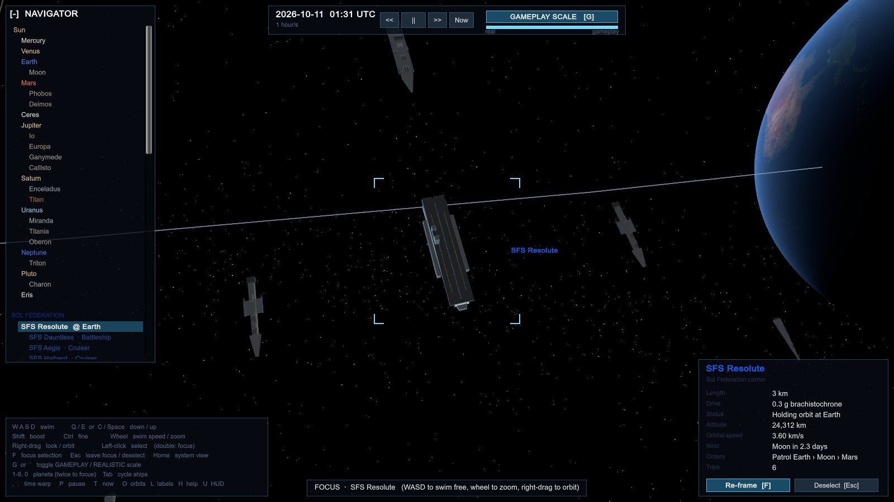 | 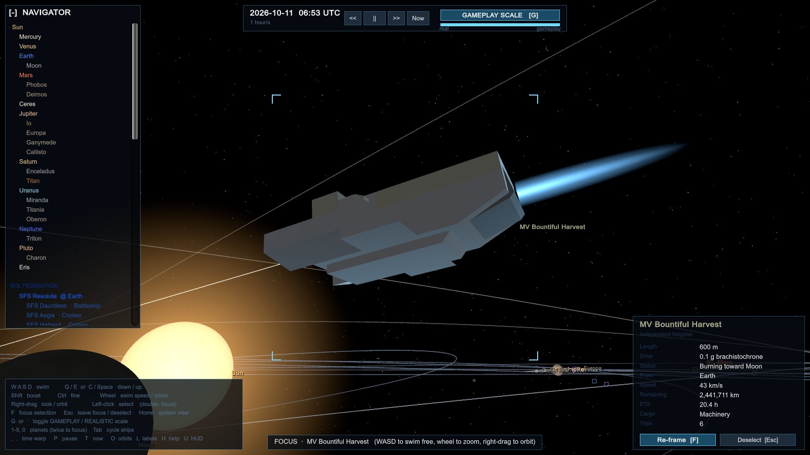 | 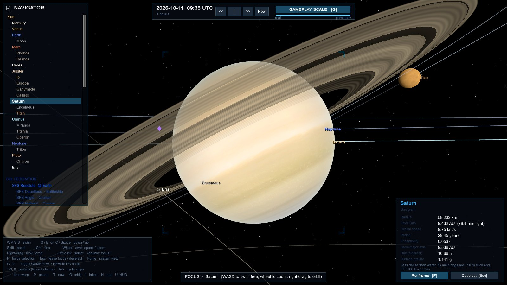 |

## Quick start

Prerequisites:

- Windows and Unity **6000.4.3f1** (via Unity Hub).
- [MindAttic.Capture](https://github.com/mindattic/MindAttic.Capture) cloned next to this repo: `Packages/manifest.json` loads its Unity package from `../MindAttic.Capture/unity/com.mindattic.capture`.
- [Unity.Shared](https://github.com/mindattic/Unity.Shared) cloned next to this repo too, for the player profiles: `Packages/manifest.json` loads it from `../Unity.Shared/unity/com.mindattic.unity.shared`, and the core tests compile its engine-free core from there (set `UnitySharedDir` to build them from a checkout elsewhere).
- Optionally the .NET 10 SDK, to run the core tests.

```bash
git clone https://github.com/mindattic/Unity.SpaceGod.git
git clone https://github.com/mindattic/MindAttic.Capture.git
git clone https://github.com/mindattic/Unity.Shared.git
```

1. Open the `Unity.SpaceGod` folder in Unity Hub. The first import takes a few minutes. The editor opens `Assets/Scenes/UnitySpace.unity` automatically (or use **Unity.SpaceGod > Rebuild Main Scene**).
2. Press Play. You start in free swim beside Earth, with Earth selected, gameplay scale on and the clock at the current date. The controls panel is open; H hides it.

Any scene works, because `Bootstrap` creates the app if the scene does not have one.

## Building and deployment

In the editor, **Unity.SpaceGod > Build Windows Player** builds `Builds/Windows/Unity.SpaceGod.exe`. Headless, with the editor closed:

```bash
Unity.exe -batchmode -quit -projectPath . -executeMethod Unity.SpaceGod.EditorTools.ProjectSetup.SetupAndBuild
```

Building never rewrites `Assets/Scenes/UnitySpace.unity`: it is generated by `ProjectSetup.CreateScene` only when it is missing, because Unity gives every regenerated object a fresh file ID and a rebuild would leave a no-op diff in git. If you change what `CreateScene` puts in the scene, run **Unity.SpaceGod > Rebuild Main Scene** and commit the scene with the code change, or the player keeps the old one.

`tools/deploy.ps1` does a clean build and publishes it: it stops any running copy, deletes `Builds\Windows` (never `Library\`), builds in batch mode with the Unity version from `ProjectSettings/ProjectVersion.txt`, and copies the player to `C:\Apps\Unity.SpaceGod\`. Add `-Launch` to start it afterwards.

```powershell
powershell -ExecutionPolicy Bypass -File tools\deploy.ps1
```

`deploy.bat` at the repo root runs the same script and also refreshes a **Unity.SpaceGod** shortcut on the Desktop that starts the published copy. In Claude Code, `/deploy` starts `deploy.bat` in its own window and `/run` starts the published game. A prompt hook (`.claude/hooks/instant-commands.ps1`) handles both before any model turn, so the orchestrator's pace holds never apply to them.

`tools\launch.bat` (or `tools\launch.ps1`) always redeploys first, then offers Normal Play, Demo + Capture (`-demo -capture video screen 5`) or Quit.

## Command line

| Flag | Result |
| --- | --- |
| `-demo` | plays the scripted camera tour once (inner system, ships, Saturn, Earth at both scales, Jupiter, docking rings, Alpha Centauri, real surfaces, battles and three staged combat showcases), then quits |
| `-modelviewer <name>` | opens straight into the model viewer on that ship model from `Resources/Ships` |
| `-continue` | resumes the latest save (quicksave, slot or autosave) instead of starting at today's date |
| `-capture ...` | records the session through MindAttic.Capture (below); independent of `-demo` |

Screenshots and video come from [MindAttic.Capture](https://github.com/mindattic/MindAttic.Capture) (needs ffmpeg on PATH). Capture is compiled into capture-enabled players only: build one with **MindAttic > Capture > Build Windows Player (Capture Enabled)** (`Builds/Capture/Unity.SpaceGod.exe`, or headless with `-executeMethod MindAttic.Capture.Unity.Editor.CaptureBuild.BuildWindows`). Capture is off unless `-capture` is on the command line.

| Command | Result |
| --- | --- |
| `Unity.SpaceGod.exe -demo -capture screen` | runs the tour once, saves a PNG at each stop and quits (how the images above were made) |
| `Unity.SpaceGod.exe -demo -capture video screen 5` | the tour, filmed, with a PNG every 5 seconds as well as at each stop |
| `Unity.SpaceGod.exe -capture video` | films the session from start to exit at native resolution |
| `Unity.SpaceGod.exe -capture screen 5` | a PNG every 5 seconds until exit |

Everything goes to `R:\MindAttic\Capture\Unity.SpaceGod\`; each tour screenshot's `.json` sidecar names the stop it shows (`"tag": "03-carrier-group"`). In the editor, the **MindAttic > Capture** menu records video or screenshots in Play Mode, and F12 takes a screenshot.

## Controls

| Action | Input |
| --- | --- |
| Swim | W A S D |
| Down / up | Q / E, or C / ] |
| Boost / fine | Shift / Ctrl |
| Look (free) or orbit (focus) | Hold right mouse and drag |
| Swim speed (free) or zoom (focus) | Mouse wheel |
| Select | Left click (double-click to focus) |
| Focus on selection / re-frame | F |
| Back out one step: close the open panels, leave focus, deselect; then the pause menu (Resume, Settings > Display, Quit) | Esc |
| Whole-system view | Home or Backspace |
| Toggle gameplay / realistic scale | G or Backquote |
| Planets: 0 Sun, 1 Mercury to 9 Pluto (in Alpha Centauri: A, B, Proxima, its planets, the stations) | Number keys (press twice to focus) |
| Cycle ships | Tab (Shift+Tab backwards) |
| Time warp slower / faster | , and . (or - and =, or numpad - and +) |
| Pause: time eases to a stop, and eases back up when pressed again | Space (or Pause) |
| Reset to now | T |
| Orbits, labels, help, HUD | O, L, H (or F1), U |
| Market board | M |
| Watch the biggest battle (at battle time) | B |
| Hyperlanes on / off | N |
| Satellite constellations on / off | K |
| Level the view to the system's plane (smooth swing: the ecliptic in Sol, the A–B orbit in Alpha Centauri) | R, or the LEVEL button |
| Fly to another star system | Navigator, STAR SYSTEMS (Esc skips the trip) |
| Galaxy map: territory, gate traffic, fronts, blockades, raiders; click a star to inspect, double-click to travel | F11, or GALAXY MAP in the navigator (F11 or Esc closes) |
| Pilot the selected ship / hand it back | P |
| Spawn and pilot any ship class | V |
| Model viewer | F9 |
| Quicksave / quickload | F5 / F8 |
| Save and load slots | F6 |
| Display: resolution, windowed / borderless windowed / exclusive fullscreen, VSync (nothing changes until Apply; Keep within 10 seconds or it reverts; kept settings are used at startup) | Esc, Settings, Display |
| Every other setting, by group or by search, with Reset | Esc, Settings |

While piloting:

| Action | Input |
| --- | --- |
| Steer | Mouse |
| Pause menu (P, not Esc, hands the ship back) | Esc |
| Throttle / strafe / rise and sink | W S / A D / E Q |
| Roll | Z X |
| Flight assist on / off | F |
| Boost | Shift |
| Cruise drive | Hold J |
| Fire forward guns | Hold left mouse |
| Lock a target | T |
| Cargo hold | I |
| Outfit the ship | F2, at a shipyard (or Outfit on the market board) |
| Silent running on / off | F3, while piloting |
| Bounty board | F4, for the selected world's port (or the one you are alongside) |
| Your fleet | F10: buy hulls and property at the port in view, hire captains, step their orders (using the selected world or ship) |
| Contracts board | F7, for the selected world's port (Take while alongside it; Abandon your own) |
| Buy and sell crates | M, near a settlement's world |
| Refuel | M, near a settlement's world (Refuel), or CALL A TANKER when the tanks are low |
| Activate a jump gate | Y, within 300 km of it |
| Answer a hail in battle | 1, 2, 3 |

## Project layout

```text
Assets/UnitySpace/
  Core/                 engine-free simulation (compiled by Tests/ as plain .NET)
    Kepler.cs             Kepler's equation, perifocal to ecliptic, vis-viva
    OrbitalElements.cs    JPL-style elements with secular rates
    LunarTheory.cs        the main terms of a lunar theory for the Moon
    BodyCatalog.cs        physical and orbital data for 26 bodies, with sources
    Ephemeris.cs          positions at any Julian date, orbit sampling
    Lagrange.cs           L1-L5 of every body pair (restricted three-body problem), Trojan lead angles
    ScaleModel.cs         realistic / gameplay mapping and its inverse
    Fleet.cs, Ships.cs    ship classes, factions, schedules, flip-and-burn and transfer-orbit transits, launch windows, lane journeys
    Trajectories.cs       universal-variable propagation, Lambert's problem, Hohmann transfers and windows, patched conics
    Hyperlanes.cs         lane network, ramps, curves, routing
    World.cs              factions, settlements, ships; advances fleet, markets and wars together
    Systems/              Alpha Centauri, the Galaxy of star systems, nearby stars, the jump-gate lattice and the traffic across it
    Infrastructure/       orbital yards, factories, habitats, real spacecraft, constellations, docking rings
    Economy/              goods, recipes, settlements and markets, trade planning, propellant (the rocket equation), the player's cargo hold
    Combat/               hardpoints, outfitting, battles, fighters, boarding, morale and surrender, wrecks, war, diplomacy, piloted flight
    Sensors/              signatures, scanner suites and the contact pictures every faction and the player's ship hold
    Information/          light-speed delay and the news between systems: gate relays, ships' data cores, stale market boards
    Persistence/          save and load: the object-graph writer and reader, the save file and its slots
    Settings/             the settings registry: declared tunables, grouped and searchable, kept per profile
    SimClock.cs           Julian-date clock and time warp
    BodyOrientation.cs    IAU prime meridians and parent-facing moons, so maps face the right way
    GasGiantWeather.cs    zonal wind profiles and the Great Red Spot's position
    AsteroidField.cs      111,267 SBDB asteroids, Kepler propagation (CPU and GPU-mirror)
  Runtime/
    Bootstrap.cs          creates the app in any scene; -demo starts the tour
    UnitySpaceApp.cs     frame loop, floating origin, picking, ship placement, piloting
    SceneTour.cs          the scripted camera tour; CaptureRunner.cs runs it for -demo
    ModelViewer.cs        the F9 model viewer
    Camera/SpaceCamera.cs free swim, focus orbit, fly-to, SOI reference frames
    Camera/StarTravel.cs  the camera's trip between star systems
    Views/                bodies, ships (hardpoints, damage, wrecks), fighters, battle effects, hyperlanes, starfield
    Rendering/            procedural meshes and ship hulls, ship models and thumbnails, materials
    UI/                   HUD and procedural icon sprites
    Input/InputState.cs   every key binding in one place
  Resources/              shaders, colour maps, ship models
  Editor/ProjectSetup.cs  scene generation and player build
Tests/
  UnitySpace.Core/       builds Core as a plain .NET library
  Unity.Shared.Core/      builds the Unity.Shared package's engine-free core (profiles) for it
  Core.Tests/             NUnit tests over Core (dotnet test)
tools/                  deploy.ps1, launch.ps1, launch.bat
docs/                   USER_STORIES.md and the README images
```

## Tests

```bash
cd Tests/Core.Tests
dotnet test
```

1214 NUnit tests, run in parallel in about ten minutes, cover the following:

- Kepler solver accuracy up to e = 0.97
- Earth's distance and heliocentric longitude at J2000
- Planet periods
- Lunar perigee and apogee, and the Earth-barycentre offset
- Every moon's position against JPL Horizons, and the Moon (lunar theory), Phobos, Charon, Ceres and Earth checked at five dates across 2000-2050, and the belt asteroids Psyche, Lutetia and Ida at two dates in 2027
- Moon spin sense
- Math helpers: angle wrapping, sexagesimal conversion, smoothstep and vector operations
- Scale-model monotonicity, invertibility and surface continuity
- No overlapping gameplay orbits
- Fleet continuity across every departure and arrival
- Brachistochrone timing, and intercepts meeting the moving target
- Velocity matching at departure and arrival
- Transits at gameplay scale leaving and joining parking slots exactly, never jumping, and staying out of the bodies at their ends
- Body orientation: Greenwich against sidereal time, synchronous moons facing their planet, Pluto's 0° meridian on Charon, map-north conventions
- Great Red Spot longitude against the JUPOS track, and wind profiles (anticyclonic shear around the spot, retrograde rotators)
- Asteroid positions against JPL Horizons (Vesta, Pallas, Hektor), the GPU propagation path, Kirkwood gaps at 3:1, 5:2 and 7:3, both Trojan clouds, and the shader's scale mapping
- Economy: every good produced in roughly the amount used, prices rising with scarcity, two years of trade with nobody going hungry and most traders in profit, traders only docking where welcome
- Economy internals: market pricing and its clamps, the production tick and limiting inputs, population growth and decline, trader cargo choice and booking
- Combat: the stronger group winning and hardpoints taking the damage, reactor and shield-generator losses, hardpoints sitting on the hull, shield arcs, coarse steps at high warp, and two years of war with battles, losses and a working economy
- Weapons: railgun and gun rounds' travel time, lead and size-dependent misses
- Salvage: latching only alongside with velocities matched, what a derelict is left with (cargo, stores, survivors, raiders aboard), fighting through raiders before anything is taken, the grid hold filling, stripped parts fitted or scrapped, claiming a flyable hull with a prize crew, a live derelict lying where it was taken, and the adventure on a hulk seen through only by working it
- Outfitting: slots from each design, modules only where they fit (a railgun only bearing on the bow), materials bought from the yard's stock at its prices and the old part sold back, a yard short of a material or an owner short of credits fitting nothing, hardened shields, armour plate (and the delta-v its mass costs), torch drives, racks that enlarge both holds and cannot come out full, scanner reach, the brig's prisoners and their bounty, damage and crew carried through a refit, and navies and raiders upgrading their warships at their own yards
- Wrecks and surrender: lasting wrecks with salvage and expiry, hulls striking their colours, ransom, prize-taking and pirate cargo demands
- Escape pods and crews: pods fitted per 20 aboard, more escaping a slow death than a reactor going up and nearly all a scuttling, the pods launched where the hull died and drifting off, a battle's fighter pilots in one cluster, rescue paid by the owners with the crew back in the pool, pirates' hostages ransomed (or pressed into service when nobody pays, or freed when their haven falls), prisoners going home at a ceasefire, raiders' pods giving their haven away, pods lost when their air runs out, only ships at the pods' body (not the player's, not one in a fight) finding them, yards that cannot crew a hull laying none down, recruiting up to the reserve, morale falling with deaths, the pod adventure (picked up alongside, lost to someone else or to the air running out, held for ransom by a pirate pilot, raiders handed to the hunters), and five months of the live system with pods rescued, taken and lost
- War and diplomacy: siege length and port capture, symmetric relations, docking rules
- Economic shocks: a mine accident cutting output until it clears, a worked-out seam cutting a mine for good and a new strike after repeated cuts, a blight spoiling food and raising its price, a strike when wages lag prices (industry stops, life support runs, a raise settles it), rationing at war that lifts with a ceasefire, a besieger's blockade shutting a port to every ship, an embargo on a neutral running war goods to the enemy that lifts with the war, price spikes reported once with their cause, and a year of the live system with shocks on their own and nobody starving
- Pirate havens: the hidden belt havens found by scanner range, by trailing beaten raiders or by a parked warship's sweep, the garrison and raiders blocking an assault, boarding (goods seized) or destroying a haven, its raiders lying low until it is rebuilt, a navy assaulting a haven it has found, and new bands sailing only from standing havens
- Patrol wings and commanded combat: dozens of patrol hulls in Sol (light and heavy fighters, destroyer pickets) on beats of their own navy's ports that between them cover every port, wings never merged, sent away or made the home guard and ordered only to patrol, defend, hunt or repair on their beat, a wing going to defend a threatened port on its beat, enemy groups passing on open ground without a fight until one is ordered to attack there, and a raider running the player down only on the ground it is ordered to raid
- Supply convoys and local traffic: each navy's escorted convoys running naval stores round its own ports and going on round their run rather than turning aside to fight (to a yard when hurt); Sol's buses, taxis and 1-, 4- and 6-seat personal craft, unarmed, untrading and off the fuel markets, scaled to each port's people, keeping to their own planet's neighbourhood for days of flying, buses calling stop by stop round their lines, and none swept into a fight or flying into one
- Raider doctrine: a band's nerve growing with a mark's worth, a juicy escorted mark taken where a poor one is left, a civilian left alone unless it pays well or carries a VIP, raiders aiming for shields and engines and never a merchant's reactor, holding fire on a disabled merchant and demanding its cargo, the crew jettisoning it and going free, the band withdrawing from the escort once it has the cargo, a refusal answered with the guns, a destroyed merchant drawing heat on its clan, and a navy sending a group to hold its gate against raiders lying off it
- Fighters: launch, attack runs, guns and torpedoes, a loose formation that breathes, lead succession, and landing back aboard
- Boarding: fighting through to the bridge and engineering, a small party repelled, vacuum killing crew only until the bulkheads seal, pods bouncing off shields and boarding once they are down, a breacher ramming home, lining up alongside a disabled ship, and a year of lane ambushes and prizes
- Hyperlanes: every system reachable, lanes clear of the Sun, trips taking a day or two instead of weeks, continuity across every leg change, and drawn lanes meeting the burns at the ramps; the piloted hull flying in through a ring gate, riding the lane AI traffic rides, coming off at the far ramp or carrying on along another lane from right where it is, handed back to the fleet mid-ride, and a ride of hours warped to under a minute; a raider's field ahead picked up as it comes into the scanners' reach with a countdown that matches the pulse, the pulse throwing the piloted hull out stunned into a fight on the lane it flies, a warship that makes out the hull braced, a surge speeding the rest of the ride without a jump, slipping the pulse or caught anyway, and dropping out short of the field to stay clear and get back in where it left; a ring chain evenly strung and flown through in order, sped up then braked; a spur per gate in every system with a network, joined only by flying through its ring the right way, ridden to within range of its gate, and picked up again at the far system's spur after the jump
- Alpha Centauri: the A–B separation (11.2 to 35.4 AU), period, barycentre balance and 2035 periastron; the orbit's 79.2° tilt to the sky; Proxima where the sky puts it and its planets' periods; the Sun in Cassiopeia as seen from there; lanes connecting every port and clearing all three stars; two years of trade, raiding and nobody starving; every system on one clock
- Nearby systems: every planet keeps its catalogued period, axis and eccentricity (periapsis and apoapsis traced, the orbit closing after one period); every star its mass, size and light; the binaries balanced on their barycentres, swinging a(1 ± e) apart, at periastron on the catalogued date and tilted as measured; spot checks against the Exoplanet Archive; candidates labelled; habitable-zone flags (Proxima b in, Barnard's planets out, the Sun's zone 0.98–1.69 AU); Epsilon Eridani's belts and Tau Ceti's disc; each system at its parallax distance; a quiet year in every unsettled system
- Avoidance: head-on ships passing wide, ships sharing a spot spreading out, a month of the whole system with no near-collisions, free ships roaming, a mid-flight course change keeping position and momentum, and merchants turning aside from fresh battles
- Lagrange points: the collinear distances against Horizons' percentages and the Hill radius, all five points equilibria in the rotating frame for any mass ratio, Sun-Earth L1, L2, L4 and L5 and Earth-Moon L1, L2, L4 and L5 against JPL Horizons, every pair's points in their places, the depots, relays and gateways at their points, and Jupiter's L4 and L5 structures staying co-orbital (60° ahead and behind, at Jupiter's distance) for four years
- Jupiter Trojans: Hektor, Patroclus and Eurybates against JPL Horizons on two dates, and each staying in its swarm 25-100° from Jupiter across 2020-2035; the Greek camp's mines, their lanes and the hidden haven on Patroclus with no lane to it
- Infrastructure: rings staying over their cities (latitude and longitude to a millionth of a degree, velocity = ω × r), including a ring over a world that keeps one face to its parent built before the ephemeris has a date; FIFO queues clearing at most one ship per interval; no position jumps through queue, descent, landing and climb; only merchants landing; yards launching from their slips; constellations at their real altitudes and inclinations; JWST at L2
- Piloting: Newtonian flight (momentum conserved with no thrust, a burn changing it by exactly its impulse, drift and turn-and-burn with flight assist off, assist settling on the commanded velocity without overshoot, rolls, gravity close to a world and a hull too weak for it settling on the surface), cruise spooling up and dropping out, collisions (capsule and sphere volumes, a fast pass caught between frames, momentum conserved in rams and scrapes, a station or a pinned body holding still, energy going as the square of the closing speed and damage with the energy, light hulls wrecked and heavy ones marked, the struck side's hardpoints and shields taking it, hard landings, a kill in battle and a wreck left outside one), forward guns firing only on the trigger, the piloted hull staying where the pilot loop puts it; per-family flight models (every class in a family, a new model plugging in for its family alone, the families without a model of their own flying exactly as before, and the light fighter carving through a break where the Newtonian hull slides, holding its track to the nose at the corner speed, turning wider under boost and strafing harder)
- Propellant: every design's drive and tanks, delta-v budgets by Tsiolkovsky (a full hold shrinking them), burns throwing out what the rocket equation says, a flip-and-burn costing its acceleration times its flight time plus the velocity match, transits charged their delta-v at the ship's mass, a short ship waiting in port, running dry (or holed), drifting, calling a tanker and carrying on, a change of course refunding the leg not flown, refuelling buying the cheaper reaction mass and its helium-3 and showing up as market demand, trades left out when the tanks cannot cover them, runs priced by their propellant and lane tolls, lane tolls going to the ramps' keeper, two months of the live system with tanks kept up, hand-flown thrust paid for and a dry hull coasting, and dry ships' distress calls answered with a propellant transfer
- Trajectories: Hohmann transfer times and burns against the textbook (Earth to Mars in 259 days on 2.94 and 2.65 km/s, LEO to GEO in 5.26 hours on 3.89), Mars windows every 780 days with Mars 44.3° ahead and the wait to the next one, universal-variable propagation against Curtis's example 3.7, Kepler's equation and running backwards, the Lambert solver against Curtis's example 5.2 and sixty random arcs (short and long way, elliptic and hyperbolic) that land on their targets, Lambert half a turn round reproducing the Hohmann transfer, Earth's and Mars's spheres of influence, the 3.6 km/s escape burn from low orbit, escape and capture hyperbolas leaving and arriving along v∞, gravity losses, a freighter flying a coasting transfer from parking orbit to parking orbit with its drive lit only at the ends, a courier keeping its flip-and-burn and paying its gravity correction, cheap freight to Mars on a patched conic with continuous handoffs, a slow boat that just missed its window waiting for the next, urgent cargo paying for speed, and the living system's haulers on transfer orbits while warships flip and burn
- Cargo hold and trade: crate footprints and rotation, no overlaps or out-of-bounds placement, buying and selling at the AI's prices and taxes, docking rules
- Sensors: signatures (burns and weapons fire bright, silent running dim but not a burn, hulks cold, a landed ship hidden, bigger hulls warmer), contacts resolving from a blip to a class to an identity as they close (at once by transponder), scanner suites reaching further and resolving finer, the player's picture holding a cold track and losing it after the hold, a faction knowing only what its ships and stations saw (a merchant at Earth by its transponder), a navy tracking a raider to a hidden haven, a merchant's haven sweep reaching less than a warship's, a fight witnessed further off than something dim, a lurking raider caught by a warship's, an escort's or a scanner suite's sensors but not a merchant's, and silent running slipping past a patrol at a distance where going dark mid-scan is running from it
- Information lag: light taking 499 s an AU, a contact seen where it was by exactly the light time across the gap, a navy at Jupiter hearing of raiders at Earth only a light time later and still acting on the old look after they have slipped away to Mars, the relay's lag between systems (light to the gate, the crossing, light in from the far gate) and a blockade sending it the long way round, a ship through the gates carrying the news and its headlines (older news never overwriting newer), and a freighter setting out on a stale report of a far shortage that the real market no longer has
- Law: jurisdictions (worlds, lane keepers, lawless havens), witnesses in sensor range or none, a recorded crime's notoriety, standing and bounty, lawless space falling to the victim's faction, notoriety fading and bounties lapsing, piracy charged to the raider captain with the bounty on their head, nothing recorded with no survivor or witness, war and self-defence exempt but an attack at peace an assault, ransom as piracy, hunting a wanted ship lawful, the patrol enforcing the law exempt and a captured wanted ship's bounty collected, docking refused and fines paid, standing moving prices, contracts withheld, stolen goods from a haven refused at lawful markets, a patrol's scan confiscating contraband, running from a scan, the order to heave to paid off or ending in an interdiction, trespass, and the player opening fire on a lawful ship
- Trading companies: every merchant hull in Sol and Alpha Centauri owned by a named company with a home port, its own livery and standing (shunned by its flag's enemy), its hulls' profit booked to the company less running costs and tax, a hull ordered at its home yard when its fleet's earnings pay one back and the yard building it on the company's money and delivering it, a navy at war worn below strength building its warships first, none bought when hulls do not pay or the reserve is short, routes chosen by profit a day (a losing run never, a cross-system run recognised), captains never planning a run to a faction that shuns their company, deliveries raising standing, a company deep in debt selling hulls to the breakers and going bankrupt, one in debt too long wound up with hulls left, a bankrupt's hulls going to a rival that can use them, a struggling company bought out by a friendly rival but never by an enemy's, new companies founded at the busiest port without one only when the trade pays, and three hundred days of the live system with every merchant launch a company's order
- Outlaws: every raider captain on the books with the adventures' name, a flagship and a haven, kills, robberies and ransoms going on the record and on the bounty, a captain killed or taken finished but kept, the boards listing whom each owner wants with last-known position (and never a hidden haven), daily sightings, a feared name after 120 days (bounties up by half, crews breaking sooner), hunters taking only contracts they can match and going where the target was seen, collecting every bounty on a kill at the dead rate, and moving on the wanted player but never on one who is not, and half a year of the live system with records built, boards filled and hunters at work
- Holdings: buying a hull (the account debited, the yard paid, the house flag, laid up without a captain), refusing what the account or a haven cannot do, enlisting a ship and its cargo, a trade route worked stop by stop (and rejoined from off it), a patrol's round, a mining claim's free holdful and its cutting time, an escort shadowing its charge and standing down when it is lost, losses on the books, trade takings into the account, daily wages and a captain walking off unpaid, captain skill, station-share dividends and a seized share, a warehouse's stock and rent, and five months of the live system with a trader and a miner earning their keep and the books balancing to the credit
- Belt mining: rocks captured, ground and separated with every tonne accounted for, elements in proportion to the rocks (platinum a trace, no manufactures), convoys timed by the real distance and filling the warehouse, a shipyard built only from its own builder's warehouses and handed to its world when done, a finished Dyson ring laying down the next, convoys robbed far more often than warehouses raided, escorts and guards cutting the risk, the plunder going to the raiders, and Sol's belt works running in the live system and through a save
- Contracts: freight posted only for a market actually short of a good, from a port with it to spare and never twice for one need, none for a well-stocked market, offers expiring untaken and coming down once the shortage is filled, a taken contract failing past its deadline, pay rising with distance, danger and urgency, the player signing at the board, handing the lot over and being paid by the patron with standing up, abandoning costing standing until the patron offers nothing, a merchant buying the lot, keeping it from other markets on the way and delivering it, cargo gone elsewhere failing the contract, passengers and colonists posted from real migration and actually moving, free ships surveying unvisited bodies, a patrol posted over a port that has seen fighting and flown by a hunter, a bounty on the law's books posted at the poster's port, and a month of the live system with the boards filling and captains working them
- Alive or dead: hunters sailing with a brig, a boarded flagship's captain locked in a berth and handed over for the full price at a port that pays (and on its own when a hunter lies there), ransom freeing them still wanted, a breached brig letting them go, hunters holding fire on a disabled quarry, the player's kill paying half only once the wreck is scanned and lapsing if it breaks up first, a captain ejecting still wanted and taken by whoever tractors the pods in, lost with pods left alone, freed by raiders to command the next band, and breaking out of a dying hull's brig into its pods
- Adventures: each kind offered only from real sim state (a ship actually in a fight or adrift, a derelict, a wreck with salvage, raiders lurking on a lane past the danger threshold, a merchant on a dangerous lane with time left, a raider captain), within range, never twice at once, capped, rested after it ends; ignored ones failing at expiry or when the situation settles without the player; completed ones paying credits, cargo and standing; and twenty days of the live system where every offer traces to something real
- Jump gates: a gate pair per link at each system's outer edge, activation range, arrival inside the far gate, and the ship moving between fleets
- Save and load: a world saved and loaded byte for byte the same, then both run on for 20 days in step; the whole galaxy saved to a slot mid-battle and loaded with the clock, the warp, the pilot's ship, purse, reputation and motion, its battles still reporting to the loaded war, then both run on for 10 days in step; the loaded world wired to itself (its callbacks point at its own parts) and still sharing the static ship designs; autosaves taking turns over three slots, the slots listed newest first, and a file that is not a save refused; and the graph writer's shared references, cycles, comparers, queues, stacks, grids, nullables, boxed values, empty arrays, delegates and random number state
- Gate network: a sparse, connected lattice linking each system to its nearest, gates facing their partners and owned by each system's power, crossing time growing with distance, routes going round a blockade and never through an enemy's gate, the distance markup deciding whether a cargo pays, a freighter selling its goods in the other system's markets, a survey ship crossing several gates and coming home, raiders getting a gate shut behind them and a navy sent after them, a ship turning for another gate when its own shuts, and a year of traffic with every ship somewhere real

## Limitations

- **Planet elements are a fit.** The JPL table is accurate to roughly arcminutes across 1800-2050 (measured against Horizons over 2000-2050: Mercury to Neptune within 0.16°), and drifts outside that window.
- **Moons are mean orbits.** The Moon follows the main terms of a real lunar theory (within 0.01°), and Phobos includes its tidal decay (within 0.07°). Every other moon is an ellipse with steady precession, within 0.5° of JPL Horizons over 2000-2050 except Miranda (1.7°), whose neighbours' pulls a mean orbit cannot follow.
- **Ship drives are fiction.** The kinematics are real, but sustained 0.06 to 1.2 g torch drives are not, and transits ignore solar gravity, which is negligible at those accelerations. Piloted flight is Newtonian (thrust over mass, torque over inertia, momentum carried, gravity close to a world), but the masses and thrusts are set for feel, a light fighter's flight computer pulls its track round with more grip than its thrusters could give, collisions push through the centres (they impart no spin) and only the piloted hull collides, the assist's set speeds are game numbers, gravity is cut off beyond four radii, and spin about each axis is integrated on its own without gyroscopic coupling.
- **Gameplay scale bends paths.** Ships fly their true path at both scales, but gameplay scale draws it through the same compression as the planets, eased near each end so the ship stays outside the inflated worlds. In a crowded moon system an inflated neighbouring moon can still be drawn over a passing ship.
- **Alpha Centauri is part guesswork.** The A–B orbit and Proxima's place are measured; the planets' orbital planes and phases, their radii and Proxima's orbital plane are assumed, and two of its worlds may not exist. The jump gates sit 5,000 km out so a pilot can reach them, not light-years away; AI ships fly the in-system legs to and from them, but the gates themselves, their crossing times and the lattice are fiction. Only Sol and Alpha Centauri are settled, so interstellar trade and raiding run between those two; the other systems are crossed and surveyed. The trunk lanes across 12,000 AU in days are deep fiction.
- **The game layer is fiction.** Settlements, factions, production rates and prices are invented (on plausible worlds); hyperlanes and torch drives are not physics. Battles are fought at bodies and, by pirate interdiction, beside hyperlanes; patrols hail and interdict only the player's ship (NPC raiders are fought by the war as before), and a crime's witness is whoever was in range, without line of sight or reporting delays; ships on flip-and-burn transits cannot be intercepted. Marines are not drawn yet (the interior model is ready for a shipboard view). There is no campaign or win condition; you observe, or fly one ship at a time.
- **Navies do not burn propellant yet.** Civilian ships fly on real propellant; warships' tanks are carried for when they are piloted, but their fleets do not draw on the markets until they have a supply chain of their own. Nor does a ship on an interstellar voyage while it runs in to a jump gate (a crossing of the whole system that no tank would cover), and the tank masses are an economic scale, apart from the flight model's much heavier hull masses.
- **Piloting is partial.** A piloted ship riding a hyperlane gets no warning of a lane ambush (the raiders' pulse passes it by), and pays no toll. Only ships can be piloted. Stripping a part takes the soundest (or the one that fits your hull); there is no picking from a list yet.
- **Saves belong to their build.** A save is the simulation's own objects written field by field, so it survives fields being added or removed, but a later build whose code has moved (its lambdas renamed by the compiler) may refuse an older save. A salvage latch in progress is let go when a save is loaded, and a save cannot be made between the stars (the autosave waits until the trip is over).
- **Surfaces are wrapped on spheres.** Phobos, Deimos and the other small irregular moons are drawn round. Relief is shading only (exaggerated about 5×), never displacement, and lunar libration is not modelled.
- **Weather is a model on a 2015 snapshot.** Jupiter's map is Hubble's of January 2015, turned so the Great Red Spot is where it is today; the other storms on it are 2015 weather. The flow map reproduces real band speeds and the spot's rotation, not real storm evolution. The Saturn, Uranus and Neptune maps are stylized (CC BY), so only their motion is data.
- **Asteroids ignore Jupiter.** They fly two-body orbits from the 2026 osculating elements, drifting from their true places by roughly 0.01 AU a year. Only numbered objects brighter than H 15.5 (about 2 to 5 km) are included, and asteroids are labelled but not selectable.

## Roadmap

Planned, from the open tickets in [docs/USER_STORIES.md](docs/USER_STORIES.md):

- A distinct flight model per family of craft, tuned one family at a time: the heavy fighter (Everspace 2), capital ships (Black Flag's broadside handling on a Rebel Galaxy battle plane), haulers and the Courier ([docs/FLIGHT_MODELS.md](docs/FLIGHT_MODELS.md)).
- Piloting anything man-made: satellites, stations and single turrets, not just ships.
- Shield bubbles that ripple where a hit lands.
- Warning of, and a response to, lane ambushes for the piloted ship.
- Hidden pirate bases on real belt asteroids.

## Documentation

- [docs/USER_STORIES.md](docs/USER_STORIES.md): every story and ticket, with the test that proves each one. It is generated from the MindAttic.Workflow database; change tickets with the workflow CLI, not by hand.
- [Assets/UnitySpace/Resources/Textures/SOURCES.md](Assets/UnitySpace/Resources/Textures/SOURCES.md): where every surface map comes from and its caveats.
- [Assets/UnitySpace/Core/Systems/SOURCES.md](Assets/UnitySpace/Core/Systems/SOURCES.md): Alpha Centauri, nearby stars, spacecraft orbits and ring sites, with the assumptions made.
- [docs/FLIGHT_MODELS.md](docs/FLIGHT_MODELS.md): how each family of craft flies, the flight-model extension point, and the plan for the families still to come.
- [AGENTS.md](AGENTS.md): instructions for coding agents working in this repo.

## License

The code has no LICENSE file yet, so all rights are reserved. Third-party assets keep their own licences:

- Planet colour maps: NASA / USGS (public domain). The Saturn, Uranus and Neptune maps are by [Solar System Scope](https://www.solarsystemscope.com/textures/), **CC BY 4.0**. Details in [Assets/UnitySpace/Resources/Textures/SOURCES.md](Assets/UnitySpace/Resources/Textures/SOURCES.md).
- Moon colour and LOLA elevation: [NASA SVS CGI Moon Kit](https://svs.gsfc.nasa.gov/4720/) (Ernie Wright; LRO LROC and LOLA teams). Jupiter: Hubble OPAL map via [NASA SVS](https://svs.gsfc.nasa.gov/12021/) (Simon, Wong, Orton). Moon, planet and satellite mosaics and DEMs: USGS Astrogeology, NASA PDS (MOLA MEGDR), and JPL's Solar System Simulator maps (Caltech/JPL/USGS) for Miranda, Titania and Oberon.
- Asteroids: [JPL Small-Body Database](https://ssd-api.jpl.nasa.gov/doc/sbdb_query.html). Great Red Spot position and drift: British Astronomical Association Jupiter Section and JUPOS. Zonal winds: Porco et al. 2003, Sánchez-Lavega et al. 2000, Sromovsky et al.
- Freighter, ore hauler and courier models: [Kenney Space Kit](https://kenney.nl/assets/space-kit), CC0.
- Hull plating: [ambientCG MetalPlates015A](https://ambientcg.com/a/MetalPlates015A), CC0.
- Alpha Centauri, nearby stars, spacecraft orbits and ring sites: see [Core/Systems/SOURCES.md](Assets/UnitySpace/Core/Systems/SOURCES.md).
- Orbital data: JPL Solar System Dynamics, the IAU WGCCRE report, and NASA planetary fact sheets.

Part of [MindAttic](https://mindattic.com) — see more projects at [github.com/mindattic](https://github.com/mindattic). Related: [ExperimentSolarSystem](https://github.com/mindattic/ExperimentSolarSystem), the Babylon.js predecessor, and [MindAttic.Capture](https://github.com/mindattic/MindAttic.Capture), which records it.
